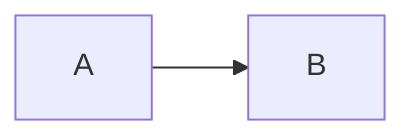

# scrawl

A web app for a folder of markdown files. Read and edit your notes from a
browser, on a laptop or a phone. One static binary, no database: the files on
disk are the only state.

- search of the whole space on `Ctrl`/`Cmd` + `K`: fuzzy, exact or by a regular
  expression, with the lines that matched; and find in the note on screen on
  `Ctrl`/`Cmd` + `F`
- an editor with live preview, on desktop and on mobile
- every file in a folder opens: a picture as a preview, a text file as
  highlighted code, and edits as plain text, without the note's preview and
  formatting
- pages and folders made in the tree or in a folder's list, dragged between
  folders, renamed and deleted; paste images straight into the editor
- export note as Markdown, HTML or PDF
- a version history per page, in a large dialog over it: what changed, shown
  the way the page reads, side by side or in one column, with the changed words
  marked; who changed it; and a restore
- several spaces at once, each a folder or a git repository it clones, serves
  and pushes back to
- a login page, users configured through the environment
- a JSON API with token auth, for scripts and agents
- a command line that renders, compares and formats markdown without the server
- a phone layout of its own: tabs at the bottom, folder lists, the notes opened
  last and a round Edit button under the thumb
- installs to a phone home screen and runs there without browser chrome; on an
  iPhone a swipe from the left edge of the screen then goes back

## Try it

```
docker compose up
```

Open http://localhost:7272 and sign in as `admin` / `admin`. It serves the
sample notes from `examples/data`, so anything you edit changes those files.

## Install it

Docker is the usual way to run it:

```
docker run -d \
  -p 7272:7272 \
  -v /path/to/notes:/spaces/notes \
  -v scrawl-data:/data \
  -e SPACE_NAME=notes \
  -e AUTH_USERS='alex:my-password' \
  ghcr.io/aleksey925/scrawl:latest
```

[examples/docker-compose.yml](examples/docker-compose.yml) is a fuller
deployment example.

You can also install it with [mise](https://mise.jdx.dev). This command
installs the latest [release](https://github.com/aleksey925/scrawl/releases):

```
mise use -g github:aleksey925/scrawl
```

To build it yourself, run `go install github.com/aleksey925/scrawl@latest`.

Run it with the same settings as the docker example, given as flags:

```
scrawl serve --space.dir ~/notes --space.name notes --auth.users 'alex:my-password'
```

## Configuration

A **space** is what scrawl serves: one folder of notes, or a git repository
cloned into one. Each space lives under `/s/<name>/`, as in
`/s/notes/doc/python/redis.md`, and has its own tree, search and history.

There are two kinds of settings:

- **Server settings** describe the server itself. They are environment
  variables and they always apply.
- **Space settings** describe what is served. For one space they are
  environment variables too. For several spaces they go into a yaml file, and
  then the space variables are ignored.

Every variable is also a flag: `SITE_TITLE` is `--site-title`, `AUTH_USERS` is
`--auth.users`. Run `scrawl serve --help` for the full list, including the HTTP
timeouts.

### Server settings

These always apply, with a spaces file or without one. Only a way to sign in is
required, everything else has a working default.

| variable           | required              | default             | meaning                                                                                                                                                                                                                                 |
| ------------------ | --------------------- | ------------------- | --------------------------------------------------------------------------------------------------------------------------------------------------------------------------------------------------------------------------------------- |
| `LISTEN`           |                       | `:7272`             | address to listen on                                                                                                                                                                                                                    |
| `SITE_TITLE`       |                       | `Notes`             | name of the site: the browser tab, the sign-in page, the home screen icon                                                                                                                                                               |
| `AUTH_USERS`       | yes, or `AUTH_TOKENS` |                     | who can sign in: `user:hashOrPassword`, comma separated                                                                                                                                                                                 |
| `AUTH_TOKENS`      |                       |                     | API tokens for scripts and agents, `name:hashOrToken[:ro]`, comma separated; enough alone for a server no browser signs in to                                                                                                           |
| `AUTH_DISABLED`    |                       | `false`             | serve without authentication, then neither of the two above is needed                                                                                                                                                                   |
| `AUTH_SECRET`      |                       |                     | cookie signing key; leave empty and one is generated and kept                                                                                                                                                                           |
| `AUTH_SECRET_FILE` |                       | `/data/session.key` | where a generated key is kept                                                                                                                                                                                                           |
| `AUTH_TTL`         |                       | `720h`              | how long a session lasts                                                                                                                                                                                                                |
| `AUTH_SECURE`      |                       | `auto`              | `Secure` flag of the sign-in cookie: `auto` sets it when the request came over HTTPS, `always` always, `never` never                                                                                                                    |
| `READ_ONLY`        |                       | `false`             | refuse every write, in every space                                                                                                                                                                                                      |
| `EXCLUDE`          |                       |                     | extra ignore globs for every space, comma separated                                                                                                                                                                                     |
| `MAX_UPLOAD`       |                       | `20M`               | upload size cap                                                                                                                                                                                                                         |
| `UPLOAD_DIR`       |                       |                     | put every upload in this one folder instead of a folder next to the note                                                                                                                                                                |
| `WATCH`            |                       | `auto`              | how changes made outside scrawl are found: `auto` - the system reports them, plus a rescan every `RESCAN`; `poll` - the rescan only. Use `poll` for a network share: the system does not report changes made there from another machine |
| `RESCAN`           |                       | `60s`               | how often every folder is reread to find changes; negative turns it off, except with `WATCH=poll`                                                                                                                                       |
| `HISTORY`          |                       | `auto`              | keep a git history of changes; `on` fails without git, `off` never touches the notes; always on for a space that is a git repository                                                                                                    |
| `TRUSTED_PROXY`    |                       | `false`             | trust `X-Forwarded-For` and `-Proto`; set it behind a reverse proxy                                                                                                                                                                     |
| `TZ`               |                       | `UTC`               | timezone                                                                                                                                                                                                                                |
| `DEBUG`            |                       | `false`             | debug logging                                                                                                                                                                                                                           |

A plain password in `AUTH_USERS` works, and the server warns about it on
startup. For anything reachable from outside, use a hash instead:

```
printf 'my-password' | docker run --rm -i ghcr.io/aleksey925/scrawl:latest hash
```

Dot directories, `node_modules` and `__pycache__` are ignored, so notes kept in
git do not expose `.git`.

If scrawl runs behind a reverse proxy (nginx, Caddy or any other), set:

- `TRUSTED_PROXY=true` - scrawl then takes the user's address from the
  `X-Forwarded-For` header and the scheme from `X-Forwarded-Proto`, instead of
  from the connection. Without it, every request comes from the proxy's
  address, and the limit on wrong passwords counts all users together: 10 wrong
  passwords from anyone lock everyone out for 15 minutes. The proxy must set
  `X-Forwarded-For` itself, otherwise anyone can write a new address there for
  each try and guess passwords without a limit.
- `AUTH_SECURE=always` - if the proxy serves HTTPS. scrawl then always sets the
  `Secure` flag on the sign-in cookie, and a browser will never send a cookie
  with this flag over plain http. This matters if the proxy still answers on
  plain http.

### One space

With one space, all its settings can be environment variables, and no spaces
file is needed.

**They are ignored when `SPACES_FILE` is set**, and the startup log warns about
each one that was set anyway. The last column shows the same setting in the
spaces file.

| variable               | required | default         | meaning                                                   | in the file      |
| ---------------------- | -------- | --------------- | --------------------------------------------------------- | ---------------- |
| `SPACE_NAME`           | yes      |                 | name of the space, the URL segment it gets                | `name`           |
| `SPACE_DIR`            |          | `/spaces/notes` | directory to serve                                        | `dir`            |
| `SPACE_FORMAT_ON_SAVE` |          | `on`            | `off` stops a save from formatting the note with prettier | `format_on_save` |

In the container the app runs as uid 1001, and the folder has to be writable
for it: otherwise the notes are read and every save fails. If the folder on the
host belongs to another user, set `user:` to the uid and gid of its owner
(`id <user>` prints them). The startup log warns when the folder is not
writable.

That is all a plain folder needs. The rest is only for a space that is a git
repository, see [A git repository as a space](#a-git-repository-as-a-space).
Leave all of it out otherwise.

| variable           | required | default | meaning                                                                                                                    | in the file                                       |
| ------------------ | -------- | ------- | -------------------------------------------------------------------------------------------------------------------------- | ------------------------------------------------- |
| `REPO_URL`         | yes      |         | the remote: the repository to clone into `SPACE_DIR` and push back to; setting it is what makes the space a git repository | `repo.url`                                        |
| `REPO_BRANCH`      |          | `main`  | branch to track                                                                                                            | `repo.branch`                                     |
| `REPO_PULL`        |          | `5m`    | how often to fetch, `0` disables the background pull                                                                       | `repo.pull`                                       |
| `REPO_TOKEN`       |          |         | token for `REPO_URL`, or a whole `Authorization` header; leave it out for a public repository or an ssh remote             | `repo.token_file` or `repo.token_env`             |
| `REPO_HOOK_SECRET` |          |         | webhook secret, at least 32 bytes; set it only to let the git host trigger a fetch                                         | `repo.hook_secret_file` or `repo.hook_secret_env` |

### Several spaces

For more than one space, describe them in a yaml file and point `SPACES_FILE`
at it.

| variable      | required | default | meaning                                                                     |
| ------------- | -------- | ------- | --------------------------------------------------------------------------- |
| `SPACES_FILE` |          |         | path to the yaml file that lists spaces; set it only to serve more than one |

The file holds space settings and nothing else. Server settings stay in the
environment. Here is a file with every key there is:

```yaml
spaces:
  # a plain folder: name and dir are all it needs
  - name: notes
    label: Personal notes
    dir: /spaces/notes

  # a git repository: the repo block is what makes it one
  - name: team
    label: Team wiki
    dir: /spaces/team
    read_only: true
    exclude: ["drafts/*"]
    repo:
      url: https://github.com/acme/wiki.git
      branch: main
      pull: 5m
      token_file: /run/secrets/gh-token # or token_env: GH_TOKEN
      hook_secret_file: /run/secrets/gh-hook # or hook_secret_env: GH_HOOK
```

| key                     | required           | default  | meaning                                                                                                                        |
| ----------------------- | ------------------ | -------- | ------------------------------------------------------------------------------------------------------------------------------ |
| `name`                  | yes                |          | URL segment: lowercase letters, digits, `-` and `_`, unique                                                                    |
| `label`                 |                    | the name | the name over the sidebar's tree and on the space's button at its foot                                                         |
| `dir`                   | yes                |          | directory to serve                                                                                                             |
| `read_only`             |                    | `false`  | refuse every write in this space                                                                                               |
| `format_on_save`        |                    | `true`   | `false` stops the editor from formatting a note with prettier when it saves it                                                 |
| `exclude`               |                    |          | extra ignore globs for this space, added to `EXCLUDE`                                                                          |
| `repo`                  |                    |          | add this block only for a space that is a git repository: `dir` becomes a clone of the remote; leave it out for a plain folder |
| `repo.url`              | yes, inside `repo` |          | the remote to clone and push back to                                                                                           |
| `repo.branch`           |                    | `main`   | branch to track                                                                                                                |
| `repo.pull`             |                    | `5m`     | how often to fetch, `0` disables the background pull                                                                           |
| `repo.token_file`       |                    |          | file holding the token for `repo.url`; no token at all for a public repository or an ssh remote                                |
| `repo.token_env`        |                    |          | variable holding that token, instead of `token_file`                                                                           |
| `repo.hook_secret_file` |                    |          | file holding the webhook secret; set it only to let the git host trigger a fetch                                               |
| `repo.hook_secret_env`  |                    |          | variable holding that secret, instead of `hook_secret_file`                                                                    |

Then start it with the file. Here `notes` is a folder on the host, and the
clone of `team` lives in the `scrawl-spaces` volume:

```
docker run -d -p 7272:7272 \
  -v ./spaces.yml:/etc/spaces.yml -v /path/to/notes:/spaces/notes -v scrawl-spaces:/spaces \
  -e SPACES_FILE=/etc/spaces.yml \
  -e AUTH_USERS='alex:my-password' \
  ghcr.io/aleksey925/scrawl:latest
```

A few rules:

- A misspelled key stops startup with an error.
- `read_only` can only add a limit. With `READ_ONLY` set on the server,
  `read_only: false` on a space does not allow writes there.
- `exclude` adds globs to `EXCLUDE` and never removes any.
- Setting both `token_file` and `token_env`, or both hook secret keys, stops
  startup with an error.

`/` redirects to the first space, and the space's button at the foot of the
sidebar, or the Profile tab on a phone, opens a menu that switches to another
one. Everything else is shared: one login, one session, one set of API tokens,
and a search that searches the space you are in.

For full separation between spaces - separate users, separate processes - run
one scrawl per folder behind a reverse proxy.

## A git repository as a space

A space may be a git repository rather than a plain folder. Give it the address
of the repository and scrawl clones it, serves it, and pushes back what you
edit. That repository, on the git host, is called the remote below. In the file
it is a `repo` block:

```yaml
spaces:
  - name: team
    dir: /spaces/team
    repo:
      url: https://github.com/acme/wiki.git
      token_file: /run/secrets/gh-token
```

With one space it is the `REPO_*` variables:

```
docker run -d -p 7272:7272 -v scrawl-spaces:/spaces \
  -e SPACE_NAME=team -e SPACE_DIR=/spaces/team \
  -e REPO_URL=https://github.com/acme/wiki.git \
  -e REPO_TOKEN='github_pat_xxx' \
  -e AUTH_USERS='alex:my-password' \
  ghcr.io/aleksey925/scrawl:latest
```

Every key and variable is listed under [Configuration](#configuration). The
rest of this section is about how such a space behaves.

**Keep the clone in a volume.** The clone lives in the space folder, together
with every commit not pushed yet. If that folder is inside the container, a
restart clones again and those commits are lost.

Mount a named volume at `/spaces` and put every clone under it: `/spaces/team`,
`/spaces/wiki`. `/spaces` already exists in the image and belongs to the user
the app runs as, so the volume is writable from the first start. A volume
mounted at a path the image does not have belongs to root, and the clone fails
with `permission denied`.

**In the spaces file the token is not written directly.** `token_file` points
at a file that holds it, `token_env` at an environment variable. With one space
it is the `REPO_TOKEN` variable. A URL with a password in it is refused:
`git clone` would save it in plain text in `.git/config`, inside the notes
folder.

**Use the token as the git host gave it** - `github_pat_...`, `glpat-...`. For
most hosts that is enough. A value that starts with a scheme name is sent as
the whole `Authorization` header instead: this is for a host that wants another
kind of header, like Bitbucket Data Center, which takes `Bearer <token>`.

A file is safer than a variable. The value of an environment variable stays
visible in `docker inspect`, `docker compose config`, a systemd unit and the
shell history. scrawl removes the variable once it has read it, but that does
not hide it from any of these.

For ssh there is no setting: an ssh remote uses the agent and the `~/.ssh` you
mount into the container, like every other tool on the box.

**Pulling and pushing.** A save is committed and pushed straight away. In
between, `pull` says how often to fetch from the remote; `0` turns that off,
but scrawl still fetches once at startup. A fetch is followed by a fast-forward
and nothing else: scrawl never merges, never rebases and never resolves
conflicts. If the branch has diverged, the space keeps serving, saves keep
landing on disk and in local commits, and a banner says so on every screen
together with a button that resets this copy to the remote version - see
[below](#when-a-space-has-diverged).

**Two things are worth knowing.** History is always on for a space that is a
git repository, whatever `HISTORY` says: one that stopped recording would also
stop pushing. And git cannot represent an empty directory, so a folder you
create reaches the remote with the first note you put in it.

A read-only space of this kind only fetches and fast-forwards. It never commits
or pushes. A file changed in its folder some other way is served, but not
recorded in git.

## A webhook instead of polling

Give a space a hook secret and the git host can tell scrawl to fetch, instead
of scrawl asking every few minutes.

```yaml
spaces:
  - name: team
    dir: /spaces/team
    repo:
      url: https://github.com/acme/wiki.git
      pull: 1h
      hook_secret_file: /run/secrets/gh-hook # or hook_secret_env: HOOK
```

With one space it is the `REPO_HOOK_SECRET` variable. Generate the secret
rather than typing one:

```
openssl rand -hex 32
```

The secret must be at least 32 bytes. The webhook URL needs no sign-in, because
a git host cannot sign in, so the secret is its only protection. If a secret is
set but turns out empty - an empty file, a variable with no value - the server
does not start: that is how a secret that failed to mount looks. To have no
webhook, set no secret. Keep the file outside every space folder: anything
inside is on the tree, in search and can be downloaded.

Paste this URL into the repository's webhook settings, with the content type
the git host offers by default:

```
https://notes.example.com/s/team/hook
```

Always use HTTPS for it: GitLab sends the secret itself in a header.

GitHub, Gitea and Forgejo are verified by `X-Hub-Signature-256`, GitLab by
`X-Gitlab-Token`. Nothing has to be configured for that: the header says which
one the sender used. The old sha1 `X-Hub-Signature` is not accepted.

**Keep a slow `pull` on.** With a webhook, `pull: 1h` is a good value: if a
delivery gets lost, the clone catches up within an hour. Nothing notices a lost
delivery, so with `pull: 0` the clone stays behind until the next delivery.

scrawl does not read what a delivery says. Any delivery means "something may
have changed" and starts one fetch, even for a push to a branch scrawl does not
track. Many deliveries at once start at most two fetches.

## When something is not reaching the remote

Nothing about this blocks you. The save landed, the note is on disk, the
history entry exists - the only thing that did not happen is the push, and
editing carries on exactly as before.

An orange "Not synced" control appears in the top bar and stays there. It says
whether the note you are looking at is affected, and clicking it lists the
affected notes. A banner above the page says the same in full, with the exact
git error. On a phone the control is an orange cloud icon in the bar on top.

The messages are:

- **Changes are not reaching the remote.** The push failed. The next save tries
  again.
- **The remote does not take changes from this space.** The push was refused:
  the space has no token, or its token may not write there. A public repository
  is the usual case - it clones without a token and takes no push without one.
  No retry fixes it: give the space a token with write access, or set
  `read_only`.
- **The remote cannot be reached.** The fetch failed. This copy may be behind,
  and if you saved anything it has not gone out either.
- **This space has diverged from the remote.** Both sides hold commits the
  other lacks: somebody pushed while this copy had commits of its own, or the
  branch was rebased or force-pushed. scrawl does not merge: nothing is sent or
  received until the copy is reset, which the message offers as a button.
- **The remote version cannot be applied here.** The fetch worked and the
  fast-forward did not, for a reason that is not a divergence - a file left in
  the way, most often. The git reason is in the message.
- **Changes are not being recorded.** Not the remote at all: a commit failed,
  so a change is on disk and not in git. The next save that succeeds commits it
  too.

When many notes are added at once, the message can say "many files are
affected" until the push goes through. Past a couple of hundred files the
per-note markers stop and the message says so.

The page refreshes this on its own, about once a minute and only while the tab
is in front of you, so a push that starts working again clears the warning
without a reload. A background refresh does not extend your session: a tab left
open would otherwise keep one alive forever.

### When a space has diverged

The banner and the top bar control carry one button, **Reset to the remote
version**. It makes this copy hold exactly what the remote holds, and it asks
first:

1. It fetches and checks what the reset would lose. It compares content, not
   commits, so after a rebase or a squash on the remote it says "nothing will
   be lost" when your changes are already there. Otherwise it lists the notes
   with changes that only this copy has.
2. If there is anything to lose, the copy is kept in a branch named
   `scrawl-backup/<date>-<time>-<commit>` before the reset. Whatever was on
   disk and not yet committed goes into it too.
3. A checkbox, on by default, also pushes that branch to the remote, so you can
   open it on your git host and bring the changes back. If the push fails,
   nothing is reset. Turn it off if something was removed from the remote on
   purpose, such as a leaked password: the backup would bring it back there.
   The branch then stays only in the clone on the server.

The reset never overwrites a file that git does not track. If the remote has a
file at the same path, the reset stops and the message names the file.

Anyone who can write can reset, and so can anyone signed in to a read-only
space: a read-only mirror whose remote was rebased needs it most. A `:ro` token
cannot reset. On a server with authentication off, nobody can reset a read-only
space from the page.

## Keyboard shortcuts

- `Ctrl`/`Cmd` + `K` searches the space, `Ctrl`/`Cmd` + `F` finds in the note
  on screen
- `Ctrl`/`Cmd` + `B` shows or hides the sidebar
- `E` opens the note in the editor, `Ctrl`/`Cmd` + `S` saves it
- `?` shows the whole list

## Markdown

Pages take GitHub's markdown: tables, task lists, footnotes, alerts as
callouts, emoji shortcodes, math, mermaid and PlantUML diagrams, `<details>`
sections as toggles and syntax highlighting, in both the light and the dark
theme. A task is ticked in the editor, not on the page.

````
> [!WARNING]
> This is an alert.

A footnote reference[^1] and a diagram:



[^1]: The footnote text.
````

A PlantUML diagram goes into a `plantuml` or `puml` block, with or without
`@startuml`:

````
```plantuml
Alice -> Bob : hello
Bob --> Alice : ok
```
````

The browser draws it, so scrawl needs no PlantUML server and no Java. The first
note with such a diagram loads a 1.7MB renderer, once. In the dark theme a
diagram is drawn dark, unless it sets colors of its own: then it keeps them and
sits on a light card. A diagram wider than the page is shown smaller; a click
opens it, or a picture, full screen, where it zooms and moves. More examples
are in `examples/data/showcase/plantuml/`. PlantUML's standard library comes
with scrawl: C4, the icon sets, the themes and emoji. A few large icon sets,
such as AWS, Azure and IBM, are left out to keep the binary small. A library is
loaded only when a diagram includes it, once:

````
```plantuml
!include <C4/C4_Container>
Person(reader, "Reader")
System(notes, "Notes")
Rel(reader, notes, "reads")
```
````

Where no browser draws, in an exported page and in `scrawl render`, scrawl
draws the diagram itself and puts it in as a picture. A simple diagram takes a
fraction of a second there, a C4 one 5 to 10 seconds and more on a slow
machine, and a large library takes a few hundred megabytes of memory for a
moment. An export gives all its diagrams three quarters of `--timeout.write`
together, counted from the start of the export, and a diagram left when that
runs out stays code, so the page still arrives; the one being drawn is finished
in the background and kept, so the next export of the note has it. A link in
such a picture cannot be clicked. Relative links between pages, in-page anchors
and images from sibling folders all keep working, and headings get anchors that
handle Cyrillic. Pasted images land in a folder next to the document and named
after it, so `python/notes.md` gets `python/notes/`. `UPLOAD_DIR` collects them
in one folder instead.

## Editing

- a save writes a temporary file and renames it into place, so a crash cannot
  leave half a document behind
- a save formats the note with [prettier](https://prettier.io) first, with its
  default options, so every note ends up looking the way `prettier --write`
  leaves it. That holds for the editor, for a write through the API and for a
  version restored from the history alike. `SPACE_FORMAT_ON_SAVE=off`, or
  `format_on_save: false` on one space in the file, turns that off
- the wand button in the toolbar, or `Shift+Alt+F`, formats the note without
  saving it, whatever that setting says
- a text file that is not a note, such as `config.yml` or a `Makefile`, opens
  in the same editor as plain source, colored by its language, with Save,
  Cancel and line wrap. It has no preview, toolbar or formatting, and a save
  leaves it as you wrote it. The editor opens text files up to 2MB
- only notes saved through scrawl are formatted. A file changed on disk or
  pulled from the remote stays as it is, so to format what is already there run
  `prettier --write "**/*.md"` in the folder once
- the editor formats in the browser, which is instant. Any other write is
  formatted by the server, which is slower: a usual note takes a fraction of a
  second, a very long one a few seconds. There a note above 256KB, or one
  prettier could not finish in 30 seconds, is stored as it was written
- with formatting off trailing whitespace is never trimmed, in markdown it can
  be meaningful
- if the file changed on disk since the editor opened it, the save is refused
  and you are shown both versions
- nothing outside the folder of a space is reachable and symbolic links are
  ignored

## API

A script or an agent uses the same JSON API the browser uses, with a token
instead of a login: no login form, no cookie jar, no CSRF header. Generate a
token:

```
scrawl token bot
```

```
token, hand this to the client: scrawl_L5Y6q1vjgguEiF8ODvE_LLBABLm339BGlpPq4VSXBcg
configuration entry for --auth.tokens: bot:sha256:d84ee1b2b0037389726bc5b846778a2a03449050e7b1b06370e10995345cf1ce
```

The token is printed once and never stored; the configuration holds only its
digest. Put the entry in `AUTH_TOKENS`, comma separated like `AUTH_USERS`, and
give the token to the client:

```
AUTH_TOKENS='bot:sha256:d84ee1b2...,reader:sha256:7bc27e33...:ro'
```

`AUTH_USERS` may then be left empty: a headless deployment needs no browser
user. A plain secret in place of the digest also works and is warned about at
startup, exactly like a plain password.

Every request carries the token in a header. A wrong one is answered with
`401 {"error":"unauthorized"}` on every path, never a redirect to the login
page.

Every endpoint that reads or writes notes lives under the space that holds
them, `/s/<space>/api/...`. The handful that read no notes - `/api/login`,
`/api/logout`, `/api/spaces` - answer at the root, and `GET /api/spaces` is
what lists the names to put in the other URLs.

```
TOKEN=scrawl_L5Y6q1vjgguEiF8ODvE_LLBABLm339BGlpPq4VSXBcg
curl -sH "Authorization: Bearer $TOKEN" http://localhost:7272/api/spaces
curl -sH "Authorization: Bearer $TOKEN" http://localhost:7272/s/notes/api/tree
curl -sH "Authorization: Bearer $TOKEN" 'http://localhost:7272/s/notes/api/search?q=redis'
curl -sH "Authorization: Bearer $TOKEN" http://localhost:7272/s/notes/api/file/python/notes.md
```

The last one answers with the source and the revision it was read at:

```json
{
  "path": "python/notes.md",
  "content": "# Notes\n",
  "rev": "sha256:6c8...",
  "size": 8,
  "mod_time": "2026-02-01T10:00:00Z"
}
```

Only a text file up to 2MB, in UTF-8, comes back this way. For any other file
the answer is `415` (not text) or `413` (too large); read it from
`/s/<space>/raw/<path>` with the same header.

To get the lines that matched, name a mode, `mode=fuzzy` or `mode=exact`, or
any of `case=1`, `word=1`, `regex=1` and `titles=1`. Fuzzy takes every word in
any order and allows one typo in a word of four letters or more; exact takes
the text as typed; `regex=1` takes an RE2 regular expression. Exact and regex
run line by line over the text as a reader sees it, so `^Install` finds a
heading and `^## ` finds nothing. Each hit then carries `title_spans`,
`match_count`, `line_count` and up to 20 `lines`, each with its line number,
its text in `spans` and a `url` that opens the note at that line with its find
bar filled in: the `url` carries `q`, the toggles that were on and `line`. A
pattern over 1KB, or a bad one, is answered with `400` and the reason.
`"truncated":true` says the search stopped early, at its time limit or after
too many matching lines, so some notes may be missing. A search that names none
of these is answered as before.

A save sends that `rev` back. If the file changed since it was read, the `rev`
no longer matches and the save is refused. Read it, then save:

```
BASE=http://localhost:7272/s/notes
REV=$(curl -sH "Authorization: Bearer $TOKEN" $BASE/api/file/python/notes.md | jq -r .rev)
curl -s -X PUT -H "Authorization: Bearer $TOKEN" -H 'Content-Type: application/json' \
  -d '{"content":"# Notes\n\nredis notes\n","rev":"'"$REV"'"}' \
  $BASE/api/file/python/notes.md
```

The reply is
`{"rev":"sha256:...","mod_time":"...","history_degraded": false,"unpublished":false}`,
and that `rev` is the one to send with the next save, so a series of writes
never has to re-read the file. An empty `rev` means "create", and succeeds only
while the path is still free.

A markdown note is formatted with prettier before it is stored, unless the
space turned that off. When that changed the text, the reply also carries
`content`, the note as it was stored, and `rev` is the revision of that text
and not of the one that was sent. `"format_failed":true` means prettier gave up
on the note and it was stored as it was sent. A client that formats on its own
side sends `"formatted":true` with the save, which is what the editor does, and
the note is stored untouched.

The last two fields are on every write, and they are two different failures.
`history_degraded` says the change is on disk and not in git. `unpublished`
says it is in git and not on the remote. A browser save gets them as a warning
and keeps going; a token gets a `500` instead, because an agent must never be
told a change landed somewhere it did not:

- `500 {"error":"the change was written but not recorded in history"}`
- `500 {"error":"the change was written and recorded, but not pushed to the remote"}`

Both fix themselves: the next commit also records what was missed, and every
push and every fetch tries again.

Two answers mean the file on disk is not what the client assumed. Both carry
`current_rev` and `current_content`, so a retry needs no second request:

- `412 {"error":"conflict",...}` - somebody else wrote the file since the `rev`
  was read. Re-apply the change on top of `current_content` and send it back
  with `current_rev`.
- `409 {"error":"already exists",...}` - an empty `rev` was sent for a path
  that already exists. Send `current_rev` to overwrite it, or pick another
  path.

The rest of the write endpoints take no revision:

| request                                 | body                            | answer                    |
| --------------------------------------- | ------------------------------- | ------------------------- |
| `POST /api/file/<path>`                 | `{"type":"file"}` or `"dir"`    | `201 {"path":...}`        |
| `DELETE /api/file/<path>`               |                                 | `200 {"path":...}`        |
| `DELETE /api/file/<dir>?recursive=true` |                                 | `200 {"path":...}`        |
| `POST /api/move`                        | `{"from":"a.md","to":"b/a.md"}` | `200 {"path":...}`        |
| `POST /api/upload/<dir>?doc=<path>`     | multipart `file`                | `201 {"path","markdown"}` |

Each is under `/s/<space>/`, and each carries `history_degraded` and
`unpublished` beside what the table shows.

A folder that is not empty is deleted only with `recursive=true`, which removes
it with everything in it; without it the answer is
`409 {"error":"directory is not empty"}`.

A token ending in `:ro` reads everything and writes nothing: every write is
`403 {"error":"read-only token, writing is disabled"}`. `READ_ONLY` on the
server refuses the same writes for every token, read-write ones included, and
`read_only: true` on one space refuses them there. All three say something
different, so a client can tell whether asking for a wider token would help.

The Export button has an endpoint too. `format=md` answers with the note as it
is stored, `format=html` with the page, its PlantUML diagrams drawn; both come
as a file to save:

```
curl -sOJH "Authorization: Bearer $TOKEN" 'http://localhost:7272/s/notes/api/export/python/notes.md?format=html'
```

## Command line

The server is one command of the binary, `scrawl serve`. The others use the
same renderer, comparison and formatter on files you name, with no server and
no configuration:

```
scrawl render note.md -o note.html        a page that opens on its own
scrawl render note.md -f fragment         the HTML alone, to put into a page of yours
scrawl render note.md -f json             the HTML, the title, the outline, the frontmatter
scrawl site -o site notes                 every note of a directory as a static site
scrawl diff old.md new.md -o diff.html    two files side by side, the way they read
scrawl diff                               HEAD against the working tree, in a git repository
scrawl diff main...HEAD -- docs           a branch since it left main, under docs/ only
scrawl format -w notes/*.md               prettier, the one a save in the app runs
scrawl stylesheet > scrawl.css            the stylesheet a fragment is drawn with
scrawl hash                               a password hash for AUTH_USERS, read from stdin
scrawl token bot                          an API token and its entry for AUTH_TOKENS
```

`diff` compares markdown as it reads. Both sides are rendered, the blocks are
lined up by their text, and only the words that changed are marked: a reflowed
paragraph, a padded table or a pass of the formatter is shown as a markup
change and not as new text. It takes revisions the way `git diff` does - none,
`REV`, `A..B`, `A...B` or `A B` - and paths after `--`, and it compares every
`.md` file the range changed, renames included. It puts the two versions side
by side; `--layout unified` shows the note once, as it reads now, with each
changed block tagged and its old and new words marked in it. `--exit-code`
exits with 1 when some text changed, and an error exits with 2.

`render` and `diff` write a page by default, `-f fragment` for HTML to put into
your own page and `-f json` for a program. A relative link is kept as written;
`--link-ext .html` turns `a.md` into `a.html` for a site built of rendered
notes. Formulas stay TeX unless `--math` puts KaTeX into the page, which makes
it some 600KB larger. Mermaid diagrams stay code, and PlantUML diagrams are
drawn into `render`'s output as pictures; `diff` keeps them as code.

`site` writes the notes as a static site, for any static host under any path,
or to open straight from disk. A page of the site is the app's reader with
nothing to write: the tree of notes with its filter, folder lists on a phone,
the outline with the section being read marked, a sheet for it on a phone, the
path to the note, a list for every folder, a copy button on every code block, a
viewer for the pictures, mermaid and PlantUML diagrams, formulas, and the theme
and page width, kept from page to page. From a host the site moves between
notes without loading the page again, as the app does; opened from disk, every
note is a page load. Search, editing, history and sync need the server and are
not on a site. The diagram renderers, some 5MB each, the formula renderer and
the PlantUML libraries the notes include are written only when a note needs
them; one library can add up to 23MB. There is nothing to configure: the front
page is the list of what the root holds, and Home opens `index.md` at the root
of the notes. A folder's `index.md` is written as `index.md.html`, beside the
folder's list. The scripts and the stylesheets are written once, into
`scrawl/`. Every other file is copied as it is, and `site` names the ones a
browser runs a script from, such as `.html` or `.svg`: opened from the site,
they run with its rights. A page still shows its note, its path and what its
folder holds without javascript. The output directory has to be empty or
missing, and `--exclude` leaves more notes out.

## Development

The toolchain comes from `mise.toml`, so
[mise](https://mise.jdx.dev/getting-started.html) is the only thing to install
by hand:

```
mise install
make deps
```

`make deps` sets up the whole working checkout: the go modules, the node
modules of the interface, of the two engines built into wasm (`format/js/` and
`plantuml/js/`) and of the browser suite, and the Chromium and Firefox the
suite drives. Run it again after pulling a change to any lockfile; a Playwright
bump wants a new browser, and without it every browser test fails with
"Executable doesn't exist".

```
make ui         build the interface into server/assets/app/ and page/assets/,
                and draw the favicon and the PNG icons from the logo
make formatter  build prettier into format/prettier.wasm
make plantuml   build PlantUML into plantuml/engine.wasm and fetch its
                library into plantuml/library/; needs the network
make build      build the binary into dist/, with the assets compressed
make run        run ./examples/data as the "notes" space, no authentication
make test       tests
make test-gzassets  tests of the build with the assets compressed
make race       tests with the race detector
make cover      race tests plus a coverage summary
make lint       every hook: formatting, go vet, golangci-lint
make e2e        the browser suite
make img        build the image
```

The interface is a react app in [web/](web/), see
[web/README.md](web/README.md). What vite builds is committed under
`server/assets/app/` and `page/assets/` and embedded with `//go:embed`, which
is what lets `go install` and the docker image work with neither node nor the
network. Change anything under `web/` and the rebuilt bundle belongs in the
same commit: CI rebuilds it and fails if what is checked in is stale.

`make build`, the docker image and the release binaries store these files
gzip-compressed, which makes the binary about 60 MB instead of about 90 MB.
`go install` builds without that step and embeds the files as they are;
PlantUML's library is committed compressed, so it is the same in both.

Browser tests live in [e2e/](e2e/), see [e2e/README.md](e2e/README.md).
