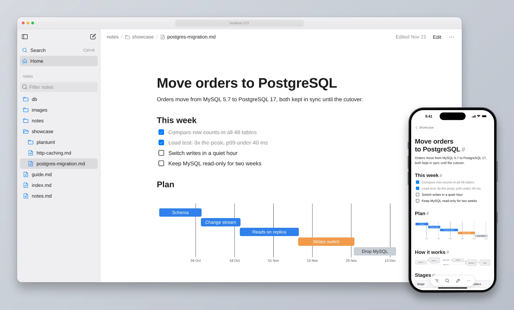

# scrawl

[](https://github.com/aleksey925/scrawl/releases/latest)
[](LICENSE)

[](https://github.com/aleksey925/scrawl/#docker)


Markdown notes in any browser, from a folder or a git repository.

scrawl lets you read and edit your notes from a browser, on a laptop or a
phone. Point it at a folder or a git repository and it serves the notes there
as they are: no database, no import, no format of its own. The files on disk
are the only state, so you can keep editing them in any other editor, sync them
with git or Syncthing, and stop using scrawl at any time without losing
anything.

It ships as one static binary or a Docker image.

<picture>
  <source media="(prefers-color-scheme: dark)" srcset="docs/screenshots/hero-dark.webp">
  
</picture>

## Features

- **Search** across all notes: fuzzy, exact or by regular expression
- **Editor** with live preview and a view of your unsaved changes
- **Consistent formatting**: every save runs the note through prettier, so all
  notes keep one style and stay easy to read and diff as plain files in git
- **Diagrams**: Mermaid and PlantUML, drawn in the browser with no Java and no
  PlantUML server
- **History**: every page keeps its past versions, with a semantic diff between
  them that ignores reformatting and marks the words that changed
- **Nothing gets lost**: unsaved text survives a closed tab, a save never
  overwrites someone else's change, and with history on every save is a git
  commit
- **Git sync**: a space can be a git repository that scrawl clones, commits to
  and pushes back
- **Several spaces** served from one instance
- **Works like a mobile app**: a phone layout built for touch, installable to
  the home screen
- **Offline access**: every note stays on the device and opens without network
- **Export** to Markdown, HTML or PDF
- **JSON API** with token auth, for scripts and agents
- **Mini apps**: run a `.html` file of your notes as an app inside scrawl, with
  its own storage, kept apart from your notes and your account
- **Static site**: turn the notes into a site for any static host, such as
  GitHub Pages, with the same reader as scrawl
- **Command line** to render, compare and format markdown, without the server

## Why scrawl

scrawl was made to have the same notes on a laptop, a work computer and a
phone, without paying for a sync service, without trusting a general-purpose
cloud drive to sync on time, and without running extra infrastructure just to
move text between devices.

So it keeps the notes in a git repository. Any git host will do, most of them
give you a private repository for free, and every change to your notes is a
commit: the notes are backed up and versioned by the same thing that syncs
them. You open them in a browser, so there is nothing to install on each
device.

**Compared to Obsidian.** Obsidian keeps the notes on each device and adds sync
on top. scrawl keeps one copy on a server and opens it from any browser; a
device can also keep a read-only copy for when there is no network: see
[Offline](#offline). With a remote repository, every change made in scrawl is
also pushed to your git host, a second copy with the whole history. Obsidian's
own sync is the paid Sync service, and the free ways each cost something:
iCloud or Syncthing has to run on every device, some plugins need a database
server or a storage bucket, and the git plugin warns that it is very unstable
on mobile. scrawl is one small binary: run it on any server, point it at a
repository, and nothing else is needed.

**When something else fits better.** If you want to edit notes with no network
at all, or a plugin for every need, Obsidian is the better tool. Offline,
scrawl only reads.

## Contents

<!-- toc -->

- [Quick start](#quick-start)
  - [Look at your notes](#look-at-your-notes)
  - [Use local folder](#use-local-folder)
  - [Use git repository](#use-git-repository)
- [Installation](#installation)
  - [Docker](#docker)
  - [Homebrew](#homebrew)
  - [mise](#mise)
  - [From source](#from-source)
- [Markdown features](#markdown-features)
  - [Formatting](#formatting)
- [How your changes are kept](#how-your-changes-are-kept)
- [Static site](#static-site)
- [Offline](#offline)
- [Mini apps](#mini-apps)
  - [On your machine](#on-your-machine)
  - [On server](#on-server)
  - [Cloudflare Tunnel](#cloudflare-tunnel)
  - [With no network](#with-no-network)
- [Configuration](#configuration)
  - [Server settings](#server-settings)
  - [One space](#one-space)
  - [Several spaces](#several-spaces)
- [Git repository as space](#git-repository-as-space)
  - [Webhook instead of polling](#webhook-instead-of-polling)
  - [Conflict with remote](#conflict-with-remote)
- [API](#api)
- [Command line](#command-line)
- [License](#license)

<!-- tocstop -->

## Quick start

### Look at your notes

Run this in a folder of markdown files:

```
docker run --rm -p 7272:7272 \
  -v "$PWD":/spaces/notes \
  -e SPACE_NAME=notes \
  -e READ_ONLY=true \
  -e HISTORY=off \
  -e AUTH_DISABLED=true \
  ghcr.io/aleksey925/scrawl:latest
```

Open http://127.0.0.1:7272 and press `Ctrl`/`Cmd` + `K` to search.

This run leaves the folder exactly as it was:

- `READ_ONLY=true` turns off editing. In normal use a save formats the note
  with prettier, which would rewrap the text of every note you save.
- `HISTORY=off` keeps scrawl from creating a git repository in the folder. In
  normal use it keeps one there to record the history of every page.
- `AUTH_DISABLED=true` skips the sign-in page, since this is only a look on
  your own machine.
- `--rm` removes the container once you stop it.

### Use local folder

To edit notes in a folder on your machine:

```
docker run -d --name scrawl --restart unless-stopped \
  -p 7272:7272 \
  --user "$(id -u):$(id -g)" \
  -v /path/to/notes:/spaces/notes \
  -v scrawl-data:/data \
  -e SPACE_NAME=notes \
  -e AUTH_USERS='admin:admin' \
  ghcr.io/aleksey925/scrawl:latest
```

Open http://127.0.0.1:7272, or the address of the machine from a phone, and
sign in as `admin` / `admin`.

- `AUTH_USERS` lists who can sign in, as `user:password`, comma separated. Pick
  your own password before others can reach the server, and put its hash there
  instead of the password itself: `scrawl hash` makes one.
- `--user` runs scrawl as you, so it can write to your folder and the files it
  saves stay yours.
- If the folder is not a git repository yet, scrawl makes it one and commits
  every change, which is where page history comes from. `HISTORY=off` turns
  this off.
- A save formats the note with prettier, see [Formatting](#formatting).
  `SPACE_FORMAT_ON_SAVE=off` turns this off.
- The `scrawl-data` volume keeps the sign-in key, so a restart does not sign
  you out.

### Use git repository

scrawl can clone a repository, commit what you edit and push it back:

```
docker run -d --name scrawl --restart unless-stopped \
  -p 7272:7272 \
  -v scrawl-spaces:/spaces \
  -v scrawl-data:/data \
  -e SPACE_NAME=notes \
  -e REPO_URL=https://github.com/you/notes.git \
  -e REPO_TOKEN='github_pat_xxx' \
  -e AUTH_USERS='admin:admin' \
  ghcr.io/aleksey925/scrawl:latest
```

- `REPO_TOKEN` is a token of the git host with write access to the repository.
  Leave it out for an ssh remote.
- The clone lives in the `scrawl-spaces` volume. Keep it: commits not pushed
  yet live there too.
- Every change is pushed a few seconds after it is saved. Changes made on the
  remote are pulled every 5 minutes.

## Installation

### Docker

```
docker pull ghcr.io/aleksey925/scrawl:latest
```

[Quick start](#quick-start) shows how to run it, and
[examples/docker-compose.yml](examples/docker-compose.yml) is a fuller
deployment.

### Homebrew

```
brew install aleksey925/apps/scrawl
```

This installs the latest
[release](https://github.com/aleksey925/scrawl/releases) on macOS or Linux.
`brew upgrade scrawl` updates it.

### mise

```
mise use -g github:aleksey925/scrawl
```

This installs the latest
[release](https://github.com/aleksey925/scrawl/releases).

### From source

```
go install github.com/aleksey925/scrawl@latest
```

## Markdown features

Notes are [GitHub-flavored markdown](https://github.github.com/gfm/), so the
syntax you already know from GitHub works as it is: tables, task lists,
footnotes, alerts, math and the rest. On top of it, scrawl adds:

- **Mermaid and PlantUML diagrams**, drawn right in the browser: no Java and no
  PlantUML server. PlantUML's standard library, C4 included, comes built in.
- **Full screen view** for diagrams and pictures: a click opens one, where it
  zooms and pans.
- **Light and dark themes**, with diagrams drawn to match.

### Formatting

Every save formats the note with [prettier](https://prettier.io), the way
`prettier --write --prose-wrap always --print-width 79` does. Whoever wrote a
note, and in whatever editor, all notes end up in one consistent style, and the
lines are wrapped so that `git diff` and your git host show changes cleanly.

- `Shift+Alt+F` in the editor formats the note without saving it.
- A note changed outside scrawl stays as it is. `scrawl format -w notes/*.md`
  brings existing notes to the same style once.
- `SPACE_FORMAT_ON_SAVE=off`, or `format_on_save: false` for one space, turns
  it off.
- The contents button in the editor puts a list of the headings between
  `<!-- toc -->` and `<!-- tocstop -->`. Every save in the editor builds that
  list again, with formatting on or off, so a change made by hand inside it is
  lost. A note saved through the API keeps the list it was sent with.

## How your changes are kept

scrawl makes sure a change is not lost and does not overwrite another one.

- **Unsaved text** is kept in the browser. If you close the tab or leave the
  editor without saving, scrawl offers to bring the text back next time. The
  editor shows "Draft on device" when the text is kept. In a private window the
  browser cannot keep it, so scrawl asks before you leave.
- **A save is all or nothing**: if the server stops in the middle, the note
  stays as it was.
- **Nothing is overwritten**: if the note changed since you opened it, on
  another device or in another editor, scrawl does not save over it and shows
  you both versions.
- **Every save goes into the history** (a git commit), so any earlier version
  can be restored. History is on by default. With a remote repository the
  change is also pushed to your git host, and scrawl retries until the push
  goes through.
- **A deleted file or folder** comes back with Undo for 5 minutes.

## Static site

`scrawl site` turns a folder of notes into a static site that works on any
static host, under any path, or opened straight from disk:

```
scrawl site -o site ~/notes
```

or with Docker:

```
mkdir -p site
docker run --rm --user "$(id -u):$(id -g)" \
  -v ~/notes:/notes -v "$PWD/site":/site \
  ghcr.io/aleksey925/scrawl:latest site -o /site /notes
```

A page of the site is the scrawl reader without editing: the tree of notes, the
outline, diagrams, formulas, and the light and dark themes. Search, editing and
history need the server, so a site has none of them. The front page lists the
notes at the root, and `index.md` there becomes Home.

## Offline

scrawl can keep a copy of every space on the device, so notes, pictures and
files open with no network. Offline everything is read-only, and search and
history are hidden, since they need the server.

- scrawl installed to the home screen has it on by default. In a browser, turn
  it on with "Offline access" in the space menu, or under Profile on a phone.
- It needs HTTPS, `localhost`, a name under it such as `scrawl.localhost`, or
  `127.0.0.1`: browsers allow it nowhere else, and on plain http the switch is
  greyed out with `Needs HTTPS`.
- The first copy downloads every space whole, plus scrawl itself. After that
  only changed files are downloaded.

## Mini apps

A mini app is a `.html` file of your notes that runs inside scrawl. Run on the
file's page opens it inside scrawl, under one bar with Back and "Open in a new
tab". If a folder has an `index.html` file, its row in a folder's list has Run
too, and Run opens that file. The app works as on any site, with its own
`localStorage`, IndexedDB, cookies and service worker, and the file is not
changed. It can load the web files of its folder and anything on the internet.
It cannot read your notes, act as you or call the API.

Every mini app runs on a host of its own. All `.html` files of one folder are
one mini app and share its data, so keep each mini app in a folder of its own,
not at the root of a space.

Where mini apps run depends on where scrawl is opened:

- [On your machine](#on-your-machine) - works with nothing to set.
- [On server](#on-server) - behind a proxy with https.
- [With no network](#with-no-network) - needs Offline access on.

Some limits:

- In Safari, on a Mac and on an iPhone, Run opens the mini app in a new tab,
  not inside scrawl. Inside scrawl, Safari keeps the app's `localStorage` only
  in memory, so everything the app saved there is lost once Safari closes. In a
  tab of its own the app keeps its data as on any site.
- On plain http at an address of your network, such as
  `http://192.168.1.5:7272`, with `MINI_APPS_URL` set, Run opens the mini app
  in a new tab in every browser. See the part for advanced users in
  [On server](#on-server).
- Inside scrawl a mini app cannot read the clipboard by itself, for example
  with a Paste button of its own. A paste you make with the keyboard or the
  menu works. In a new tab the app can ask for the clipboard as on any site,
  but not on plain http at an address of your network: there the browser gives
  no site the clipboard.
- A mini app opens only from scrawl. If you open its address directly, you see
  `To use this app, sign in to scrawl and open it from there`. If you see this
  right after Run, your browser blocks the app inside scrawl. This can happen
  when scrawl runs on your computer and the browser has strict privacy
  settings. Press "Open in a new tab" at the top: the app opens in a new tab
  and works there.
- A service worker of the mini app itself replaces scrawl's, and keeps serving
  the files it stored after the app's cookie ended, as on any site.
- A renamed or moved folder is a new mini app: the data the old one saved stays
  in the browser under its old address.
- Sign-out leaves the files and data of mini apps in the browser, as any
  site's.

### On your machine

Nothing to set. Open scrawl at the link it prints at start,
`http://127.0.0.1:7272`, not at `localhost`. In this setup the names under
`localhost`, such as `app-<id>.localhost`, belong to mini apps. If scrawl has a
password and is opened at `localhost` too, a mini app written to do harm could
sign you out of scrawl or sign you in as another user. A usual mini app does
nothing like this.

Here a mini app is not kept for use with no network, see
[With no network](#with-no-network).

### On server

On a server, mini apps run behind any proxy with https, such as nginx, Caddy or
Cloudflare Tunnel. Each mini app gets a name of its own under your domain, so
the proxy needs:

1. A DNS record `*.example.com` that points to the proxy, and a certificate
   that covers `*.example.com`.
2. These names sent to scrawl, with the `Host` header the browser sent, see
   [Server settings](#server-settings).

Then set `MINI_APPS_URL=https://app-{id}.example.com` and `TRUSTED_PROXY=true`.
With Cloudflare Tunnel, see [Cloudflare Tunnel](#cloudflare-tunnel).

What can go wrong:

- scrawl opened at an address of the network with no `MINI_APPS_URL`, such as
  `http://192.168.1.5:7272`: Run says `Mini apps do not run at this address`.
- `MINI_APPS_URL` has no `{id}`, such as `https://apps.example.com`, or only
  `{id}` in its first label, such as `https://{id}.example.com`: scrawl does
  not start, and its message shows the form to use,
  `https://app-{id}.example.com`.
- `MINI_APPS_URL` is https and a password is set, but neither
  `TRUSTED_PROXY=true` nor `AUTH_SECURE=always` is: scrawl does not start, and
  its message names the setting to add, `TRUSTED_PROXY=true` behind a proxy.
- With `TRUSTED_PROXY=true` and `MINI_APPS_URL=https://app-{id}.example.com`,
  do not also open scrawl at `http://notes.example.com`: the sign-in there is
  not protected, and scrawl does not warn about it.

**For advanced users:** to run mini apps on a home network without https, set
up a local DNS that answers any `app-...` name with the address of this
machine, and set `MINI_APPS_URL` to it, such as
`http://app-{id}.apps.home.lan:7272`. A hosts file is not enough, since it has
no wildcard. With a password, open scrawl at the IP of the machine, such as
`http://192.168.1.5:7272`, not at a name such as `notes.home.lan`: it is a
neighbor of the names of mini apps, and a mini app there can sign you out, or
into another account. scrawl logs a warning about this at start. At any plain
http address of the network, the IP or a name, Run opens the mini app in a new
tab, not inside scrawl: with scrawl at the IP, over http the browser does not
keep the app's cookie inside scrawl.

### Cloudflare Tunnel

To run mini apps behind Cloudflare Tunnel, with scrawl at `notes.example.com`:

1. In Cloudflare, open `Protect & connect` -> `Networking` -> `Tunnels`, pick
   the tunnel, open `Routing` and press `Add route`, choose
   `Published application`: subdomain `*`, domain `example.com`, the same
   service URL as scrawl. Cloudflare adds the DNS record `*.example.com`
   itself.
2. Set `MINI_APPS_URL=https://app-{id}.example.com` and `TRUSTED_PROXY=true`.

The name around `{id}` can be any, such as `notes-app-{id}.example.com`, but it
stays one level under the domain: the free certificate covers `*.example.com`
and not `*.apps.example.com`. If DNS already has a `*.example.com` record, it
must point to the same tunnel.

If a gateway with its own sign-in, such as Cloudflare Access, guards scrawl,
leave the `app-*` hosts out of it: its sign-in page cannot show inside scrawl,
and mini apps check their own cookie.

### With no network

If Offline access is on, a mini app opens with no network too, with the data it
saved, but only after you have run it once with a network in that browser.

- Only the files in the mini app's folder are kept. What it loads from the
  internet, such as a library from a CDN, is not, so such a mini app may not
  work with no network.
- A mini app with a service worker of its own decides itself what to keep.

## Configuration

A **space** is what scrawl serves: one folder of notes, or a git repository
cloned into one. Each space lives under `/s/<name>/`, as in
`/s/notes/doc/python/redis.md`, and has its own tree, search and history.

There are two kinds of settings:

- **Server settings** describe the server itself. They are environment
  variables and they always apply.
- **Space settings** describe what is served. For one space they are
  environment variables too. For several spaces they go into a yaml file, and
  then the space variables are ignored.

Every variable is also a flag: `SITE_TITLE` is `--site-title`, `AUTH_USERS` is
`--auth.users`. Run `scrawl serve --help` for the full list, including the HTTP
timeouts.

### Server settings

These always apply, with a spaces file or without one. Only a way to sign in is
required, everything else has a working default.

| variable           | required              | default             | meaning                                                                                                                                                                                                                                 |
| ------------------ | --------------------- | ------------------- | --------------------------------------------------------------------------------------------------------------------------------------------------------------------------------------------------------------------------------------- |
| `LISTEN`           |                       | `:7272`             | address to listen on                                                                                                                                                                                                                    |
| `SITE_TITLE`       |                       | `Notes`             | name of the site: the browser tab, the sign-in page, the home screen icon                                                                                                                                                               |
| `AUTH_USERS`       | yes, or `AUTH_TOKENS` |                     | who can sign in: `user:hashOrPassword`, comma separated                                                                                                                                                                                 |
| `AUTH_TOKENS`      |                       |                     | API tokens for scripts and agents, `name:hashOrToken[:ro]`, comma separated; enough alone for a server no browser signs in to                                                                                                           |
| `AUTH_DISABLED`    |                       | `false`             | serve without authentication, then neither of the two above is needed                                                                                                                                                                   |
| `AUTH_SECRET`      |                       |                     | cookie signing key; leave empty and one is generated and kept                                                                                                                                                                           |
| `AUTH_SECRET_FILE` |                       | `/data/session.key` | where a generated key is kept                                                                                                                                                                                                           |
| `AUTH_TTL`         |                       | `720h`              | how long a session lasts                                                                                                                                                                                                                |
| `AUTH_SECURE`      |                       | `auto`              | `Secure` flag of the sign-in cookie: `auto` sets it when the request came over HTTPS, `always` always, `never` never                                                                                                                    |
| `READ_ONLY`        |                       | `false`             | refuse every write, in every space                                                                                                                                                                                                      |
| `EXCLUDE`          |                       |                     | extra ignore globs for every space, comma separated                                                                                                                                                                                     |
| `MAX_UPLOAD`       |                       | `20M`               | upload size cap                                                                                                                                                                                                                         |
| `UPLOAD_DIR`       |                       |                     | put every upload in this one folder instead of a folder next to the note                                                                                                                                                                |
| `WATCH`            |                       | `auto`              | how changes made outside scrawl are found: `auto` - the system reports them, plus a rescan every `RESCAN`; `poll` - the rescan only. Use `poll` for a network share: the system does not report changes made there from another machine |
| `RESCAN`           |                       | `60s`               | how often every folder is reread to find changes; negative turns it off, except with `WATCH=poll`                                                                                                                                       |
| `HISTORY`          |                       | `auto`              | keep a git history of changes; `on` fails without git, `off` never touches the notes; always on for a space that is a git repository                                                                                                    |
| `TRUSTED_PROXY`    |                       | `false`             | trust `X-Forwarded-For` and `-Proto`; set it behind a reverse proxy                                                                                                                                                                     |
| `MINI_APPS_URL`    |                       |                     | where mini apps run: a URL with `{id}` in its first label, such as `https://app-{id}.example.com`, each mini app on a host of its own; empty runs them on `app-<id>.localhost`, see [Mini apps](#mini-apps)                             |
| `TZ`               |                       | `UTC`               | timezone                                                                                                                                                                                                                                |
| `DEBUG`            |                       | `false`             | debug logging                                                                                                                                                                                                                           |

A plain password in `AUTH_USERS` works, and the server warns about it on
startup. For anything reachable from outside, use a hash instead:

```
printf 'my-password' | docker run --rm -i ghcr.io/aleksey925/scrawl:latest hash
```

Dot directories, `node_modules` and `__pycache__` are ignored, so notes kept in
git do not expose `.git`.

If scrawl runs behind a reverse proxy (nginx, Caddy or any other), set:

- `TRUSTED_PROXY=true` - scrawl then takes the user's address from the
  `X-Forwarded-For` header and the scheme from `X-Forwarded-Proto`, instead of
  from the connection. Without it, every request comes from the proxy's
  address, and the limit on wrong passwords counts all users together: 10 wrong
  passwords from anyone lock everyone out for 15 minutes. The proxy must set
  `X-Forwarded-For` itself, otherwise anyone can write a new address there for
  each try and guess passwords without a limit.
- `AUTH_SECURE=always` - if the proxy serves HTTPS. scrawl then always sets the
  `Secure` flag on the sign-in cookie, and a browser will never send a cookie
  with this flag over plain http. This matters if the proxy still answers on
  plain http.

Over HTTPS the session cookie is named `__Host-scrawl_session`, which a site on
a neighbor name cannot set. Versions without mini apps named it
`scrawl_session`, so after the update from one of them everyone signs in once
more.

The proxy must also pass on the `Host` header the browser sent, with nginx
`proxy_set_header Host $host`. scrawl tells the hosts of mini apps from its own
by it, and Run compares it with the address of the page: with
`Host: localhost:7272` from the proxy, Run answers 403 and no app opens.

### One space

With one space, all its settings can be environment variables, and no spaces
file is needed.

**They are ignored when `SPACES_FILE` is set**, and the startup log warns about
each one that was set anyway. The last column shows the same setting in the
spaces file.

| variable               | required | default         | meaning                                                   | in the file      |
| ---------------------- | -------- | --------------- | --------------------------------------------------------- | ---------------- |
| `SPACE_NAME`           | yes      |                 | name of the space, the URL segment it gets                | `name`           |
| `SPACE_DIR`            |          | `/spaces/notes` | directory to serve                                        | `dir`            |
| `SPACE_FORMAT_ON_SAVE` |          | `on`            | `off` stops a save from formatting the note with prettier | `format_on_save` |

In the container scrawl runs as uid 1001, and the folder has to be writable for
it: otherwise the notes are read and every save fails. If the folder on the
host belongs to another user, set `user:` to the uid and gid of its owner
(`id <user>` prints them). The startup log warns when the folder is not
writable.

That is all a plain folder needs. The rest is only for a space that is a git
repository, see [Git repository as space](#git-repository-as-space). Leave all
of it out otherwise.

| variable           | required | default | meaning                                                                                                                    | in the file                                       |
| ------------------ | -------- | ------- | -------------------------------------------------------------------------------------------------------------------------- | ------------------------------------------------- |
| `REPO_URL`         | yes      |         | the remote: the repository to clone into `SPACE_DIR` and push back to; setting it is what makes the space a git repository | `repo.url`                                        |
| `REPO_BRANCH`      |          | `main`  | branch to track                                                                                                            | `repo.branch`                                     |
| `REPO_PULL`        |          | `5m`    | how often to fetch, `0` disables the background pull                                                                       | `repo.pull`                                       |
| `REPO_TOKEN`       |          |         | token for `REPO_URL`, or a whole `Authorization` header; leave it out for a public repository or an ssh remote             | `repo.token_file` or `repo.token_env`             |
| `REPO_HOOK_SECRET` |          |         | webhook secret, at least 32 bytes; set it only to let the git host trigger a fetch                                         | `repo.hook_secret_file` or `repo.hook_secret_env` |

### Several spaces

For more than one space, describe them in a yaml file and point `SPACES_FILE`
at it.

| variable      | required | default | meaning                                                                     |
| ------------- | -------- | ------- | --------------------------------------------------------------------------- |
| `SPACES_FILE` |          |         | path to the yaml file that lists spaces; set it only to serve more than one |

The file holds space settings and nothing else. Server settings stay in the
environment. Here is a file with two spaces, a plain folder and a git
repository:

```yaml
spaces:
  # a plain folder: name and dir are all it needs
  - name: notes
    label: Personal notes
    dir: /spaces/notes

  # a git repository: the repo block is what makes it one
  - name: team
    label: Team wiki
    dir: /spaces/team
    read_only: true
    exclude: ["drafts/*"]
    repo:
      url: https://github.com/acme/wiki.git
      token_file: /run/secrets/gh-token
      hook_secret_file: /run/secrets/gh-hook
```

| key                     | required           | default  | meaning                                                                                                                        |
| ----------------------- | ------------------ | -------- | ------------------------------------------------------------------------------------------------------------------------------ |
| `name`                  | yes                |          | URL segment: lowercase letters, digits, `-` and `_`, unique                                                                    |
| `label`                 |                    | the name | the name over the sidebar's tree and on the space's button at its foot                                                         |
| `dir`                   | yes                |          | directory to serve                                                                                                             |
| `read_only`             |                    | `false`  | refuse every write in this space                                                                                               |
| `format_on_save`        |                    | `true`   | `false` stops the editor from formatting a note with prettier when it saves it                                                 |
| `exclude`               |                    |          | extra ignore globs for this space, added to `EXCLUDE`                                                                          |
| `repo`                  |                    |          | add this block only for a space that is a git repository: `dir` becomes a clone of the remote; leave it out for a plain folder |
| `repo.url`              | yes, inside `repo` |          | the remote to clone and push back to                                                                                           |
| `repo.branch`           |                    | `main`   | branch to track                                                                                                                |
| `repo.pull`             |                    | `5m`     | how often to fetch, `0` disables the background pull                                                                           |
| `repo.token_file`       |                    |          | file holding the token for `repo.url`; no token at all for a public repository or an ssh remote                                |
| `repo.token_env`        |                    |          | variable holding that token, instead of `token_file`                                                                           |
| `repo.hook_secret_file` |                    |          | file holding the webhook secret; set it only to let the git host trigger a fetch                                               |
| `repo.hook_secret_env`  |                    |          | variable holding that secret, instead of `hook_secret_file`                                                                    |

Then start it with the file. Here `notes` is a folder on the host, and the
clone of `team` lives in the `scrawl-spaces` volume:

```
docker run -d -p 7272:7272 \
  -v ./spaces.yml:/etc/spaces.yml -v /path/to/notes:/spaces/notes -v scrawl-spaces:/spaces \
  -e SPACES_FILE=/etc/spaces.yml \
  -e AUTH_USERS='alex:my-password' \
  ghcr.io/aleksey925/scrawl:latest
```

A few rules:

- A misspelled key stops startup with an error.
- `read_only` can only add a limit. With `READ_ONLY` set on the server,
  `read_only: false` on a space does not allow writes there.
- `exclude` adds globs to `EXCLUDE` and never removes any.
- Setting both `token_file` and `token_env`, or both hook secret keys, stops
  startup with an error.

`/` redirects to the first space, and the space's button at the foot of the
sidebar opens a menu that switches to another one. On a phone the spaces are
listed on the Profile tab. Everything else is shared: one login, one session,
one set of API tokens, and a search that searches the space you are in.

For full separation between spaces - separate users, separate processes - run
one scrawl per folder behind a reverse proxy.

## Git repository as space

A space may be a git repository rather than a plain folder. Give it the address
of the repository and scrawl clones it, serves it, and pushes back what you
edit. That repository, on the git host, is called the remote below.
[Use git repository](#use-git-repository) shows how to start one, and every key
and variable is listed under [Configuration](#configuration). This section is
about how such a space behaves.

**Keep the clone in a volume.** The clone lives in the space folder, together
with every commit not pushed yet. If that folder is inside the container, a
restart clones again and those commits are lost.

Mount a named volume at `/spaces` and put every clone under it: `/spaces/team`,
`/spaces/wiki`. `/spaces` already exists in the image and belongs to the user
scrawl runs as, so the volume is writable from the first start. A volume
mounted at a path the image does not have belongs to root, and the clone fails
with `permission denied`.

**In the spaces file the token is not written directly.** `token_file` points
at a file that holds it, `token_env` at an environment variable. With one space
it is the `REPO_TOKEN` variable. A URL with a password in it is refused:
`git clone` would save it in plain text in `.git/config`, inside the notes
folder.

**Use the token as the git host gave it** - `github_pat_...`, `glpat-...`. For
most hosts that is enough. A value that starts with a scheme name is sent as
the whole `Authorization` header instead: this is for a host that wants another
kind of header, like Bitbucket Data Center, which takes `Bearer <token>`.

A file is safer than a variable. The value of an environment variable stays
visible in `docker inspect`, `docker compose config`, a systemd unit and the
shell history. scrawl removes the variable once it has read it, but that does
not hide it from any of these.

For ssh there is no setting: an ssh remote uses the agent and the `~/.ssh` you
mount into the container, like every other tool on the box.

**Pulling and pushing.** A change you make is committed at once and pushed a
few seconds later, so you never wait for the network, and a few quick changes
go out as one push. Even when the network hangs, saves go on: changes pile up
as local commits and go out when the remote answers again. If a push fails,
scrawl tries again about a minute later, and keeps trying until it goes
through, even with `pull: 0` and after a restart. It stops trying when there is
a conflict with the remote or the remote refuses the token, since only a person
can fix those. In between, `pull` says how often to fetch from the remote; `0`
turns that off, but scrawl still fetches once at startup. A fetch is followed
by a fast-forward and nothing else: scrawl never merges and never rebases. If
there is a conflict with the remote, the space keeps serving, saves keep
landing on disk and in local commits, and a banner says so on every screen
together with a button that resets this copy to the remote version - see
[below](#conflict-with-remote).

**Two things are worth knowing.** History is always on for a space that is a
git repository, whatever `HISTORY` says: one that stopped recording would also
stop pushing. And git cannot represent an empty directory, so a folder you
create reaches the remote with the first note you put in it.

A read-only space of this kind only fetches and fast-forwards. It never commits
or pushes. A file changed in its folder some other way is served, but not
recorded in git.

### Webhook instead of polling

Give a space a hook secret and the git host can tell scrawl to fetch, instead
of scrawl asking every few minutes.

```yaml
spaces:
  - name: team
    dir: /spaces/team
    repo:
      url: https://github.com/acme/wiki.git
      pull: 1h
      hook_secret_file: /run/secrets/gh-hook # or hook_secret_env: HOOK
```

With one space it is the `REPO_HOOK_SECRET` variable. Generate the secret
rather than typing one:

```
openssl rand -hex 32
```

The secret must be at least 32 bytes. The webhook URL needs no sign-in, because
a git host cannot sign in, so the secret is its only protection. If a secret is
set but turns out empty - an empty file, a variable with no value - the server
does not start: that is how a secret that failed to mount looks. To have no
webhook, set no secret. Keep the file outside every space folder: anything
inside is on the tree, in search and can be downloaded.

Paste this URL into the repository's webhook settings, with the content type
the git host offers by default:

```
https://notes.example.com/s/team/hook
```

Always use HTTPS for it: GitLab sends the secret itself in a header.

GitHub, Gitea and Forgejo are verified by `X-Hub-Signature-256`, GitLab by
`X-Gitlab-Token`. Nothing has to be configured for that: the header says which
one the sender used. The old sha1 `X-Hub-Signature` is not accepted.

**Keep a slow `pull` on.** With a webhook, `pull: 1h` is a good value: if a
delivery gets lost, the clone catches up within an hour. Nothing notices a lost
delivery, so with `pull: 0` the clone stays behind until the next delivery.

scrawl does not read what a delivery says. Any delivery means "something may
have changed" and starts one fetch, even for a push to a branch scrawl does not
track. Many deliveries at once start at most two fetches.

### Conflict with remote

A conflict means this copy and the remote both have changes the other does not:
somebody pushed while this copy had changes of its own, or the branch was
rewritten on the remote. scrawl does not merge, so it stops syncing and shows a
banner with one button, **Replace local copy**. Nothing is lost on the way:

- before the reset it checks what would be lost, comparing content rather than
  commits, so after a rebase or a squash on the remote it often finds nothing;
- if something would be lost, the copy goes to a branch named
  `scrawl-backup/<date>-<time>-<commit>`, together with anything not committed
  yet;
- that branch is pushed to the remote by default, so you can open it on your
  git host and bring the changes back.

## API

Scripts and agents use the same JSON API the browser uses, with a token instead
of a login. Generate one:

```
scrawl token bot
```

It prints the token to give the client and an entry for `AUTH_TOKENS`, which
holds only its digest. Add `:ro` to the end of an entry for a token that can
read and not write.

```
TOKEN=scrawl_...
curl -sH "Authorization: Bearer $TOKEN" http://127.0.0.1:7272/api/spaces
curl -sH "Authorization: Bearer $TOKEN" http://127.0.0.1:7272/s/notes/api/tree
curl -sH "Authorization: Bearer $TOKEN" 'http://127.0.0.1:7272/s/notes/api/search?q=redis'
curl -sH "Authorization: Bearer $TOKEN" http://127.0.0.1:7272/s/notes/api/file/python/notes.md
```

Every endpoint that works with notes lives under its space,
`/s/<space>/api/...`.

To save a note, send back the `rev` it was read at. If somebody else wrote the
file in between, the `rev` no longer matches and the save is refused instead of
overwriting their change:

```
BASE=http://127.0.0.1:7272/s/notes
REV=$(curl -sH "Authorization: Bearer $TOKEN" $BASE/api/file/python/notes.md | jq -r .rev)
curl -s -X PUT -H "Authorization: Bearer $TOKEN" -H 'Content-Type: application/json' \
  -d '{"content":"# Notes\n\nredis notes\n","rev":"'"$REV"'"}' \
  $BASE/api/file/python/notes.md
```

The reply carries the new `rev`, so a series of saves never has to read the
file again. An empty `rev` means "create", and works only while the path is
free. A note is formatted on save here too: when that changed the text, the
reply also carries `content`, the note as it was stored.

Two answers mean the file is not what the client expected. Both carry
`current_rev` and `current_content`, so a retry needs no extra request:

- `412` - somebody else wrote the file since it was read. Apply the change on
  top of `current_content` and send it with `current_rev`.
- `409` - an empty `rev` was sent for a path that already exists. Send
  `current_rev` to overwrite it, or pick another path.

The other writes take no `rev`:

| request                                 | body                            | answer                    |
| --------------------------------------- | ------------------------------- | ------------------------- |
| `POST /api/file/<path>`                 | `{"type":"file"}` or `"dir"`    | `201 {"path":...}`        |
| `DELETE /api/file/<path>`               |                                 | `200 {"path","trash_id"}` |
| `DELETE /api/file/<dir>?recursive=true` |                                 | `200 {"path","trash_id"}` |
| `POST /api/trash/restore`               | `{"id":"<trash_id>"}`           | `200 {"path":...}`        |
| `POST /api/move`                        | `{"from":"a.md","to":"b/a.md"}` | `200 {"path":...}`        |
| `POST /api/upload/<dir>?doc=<path>`     | multipart `file`                | `201 {"path","markdown"}` |

A write made with a token waits until it is pushed to the remote. If it lands
on disk but does not reach git or the remote, the answer is `500` with the
reason, so an agent is never told a change landed where it did not. A `:ro`
token, `READ_ONLY` on the server and `read_only` on a space each refuse writes
with `403` and their own message.

## Command line

The server is one command of the binary, `scrawl serve`. The others use the
same renderer, comparison and formatter on files you name, with no server and
no configuration:

```
scrawl render note.md -o note.html        a page that opens on its own
scrawl render note.md -f fragment         the HTML alone, to put into a page of yours
scrawl render note.md -f json             the HTML, the title, the outline, the frontmatter
scrawl site -o site notes                 every note of a directory as a static site
scrawl diff old.md new.md -o diff.html    two files side by side, the way they read
scrawl diff                               HEAD against the working tree, in a git repository
scrawl diff main...HEAD -- docs           a branch since it left main, under docs/ only
scrawl format -w notes/*.md               prettier, the one a save in scrawl runs
scrawl stylesheet > scrawl.css            the stylesheet a fragment is drawn with
scrawl hash                               a password hash for AUTH_USERS, read from stdin
scrawl token bot                          an API token and its entry for AUTH_TOKENS
```

## License

[MIT](LICENSE)
