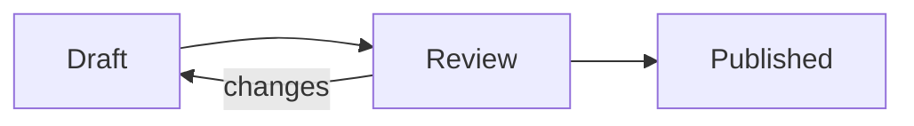
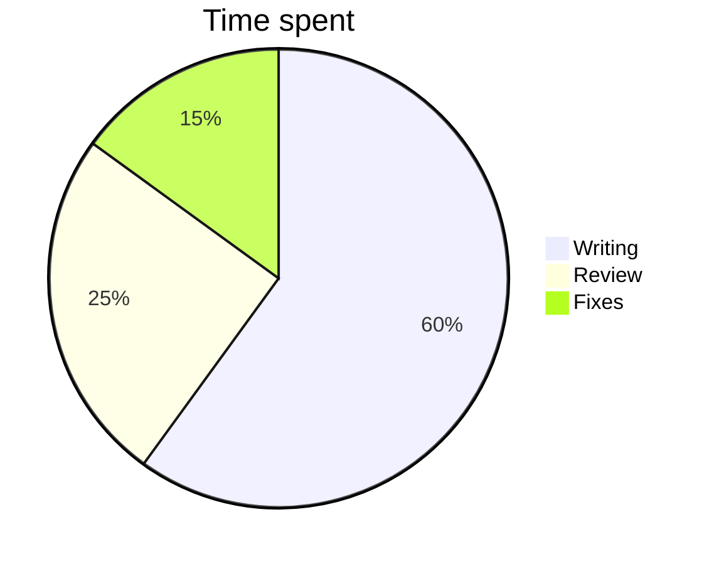
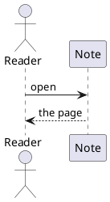

# Writing notes

Everything a note in this space can use, each with the way to write it. Back to
the [index](index.md).

## Text

**Bold**, _italic_, **_both_**, ~~struck out~~, `inline code` and
<mark>highlighted</mark>. Keys: <kbd>Ctrl</kbd>+<kbd>K</kbd>. Small things:
H<sub>2</sub>O, 2<sup>10</sup>, <abbr title="Write-ahead log">WAL</abbr>,
<ins>inserted</ins> and <small>small print</small>. Emoji by name: :rocket:
:white_check_mark: :warning:.

A line ends with a backslash\
to break here without a new paragraph. A character that means something in
markdown is escaped: \*not italic\*.

## Links

- to another note: [data storage](databases/storage.md)
- to a heading of it: [indexes](databases/storage.md#indexes)
- to a heading here: [tables](#tables)
- to a note not written yet, which offers to create it:
  [meeting notes](meeting-notes.md)
- to a file that is not a note, which opens as text:
  [slugify script](scripts/slugify.py)
- to a site: [RFC 9111](https://www.rfc-editor.org/rfc/rfc9111), or a bare
  address: https://go.dev and www.postgresql.org

## Lists

- a list item
  - a nested one
    - and one more level
- [x] a done task
- [ ] a task still open

1. first
2. second
   1. a nested step
   2. another one
3. third

A numbered list can start anywhere:

7. seventh
8. eighth

<dl>
  <dt>Term</dt>
  <dd>Its definition, written as HTML.</dd>
  <dt>Another term</dt>
  <dd>One more definition.</dd>
</dl>

## Tables

| Left          | Center | Right |
| :------------ | :----: | ----: |
| `max-age=60`  |  yes   |    60 |
| `no-store`    |   no   |     0 |
| **bold** cell |   -    | 1,024 |

## Quotes and alerts

> A quote can hold **markdown**.
>
> > And a quote inside it.
>
> -- someone wise

> [!NOTE]
> Written as `> [!NOTE]` on the first line of a quote.

> [!TIP]
> A tip, `> [!TIP]`.

> [!IMPORTANT]
> Something to keep in mind, `> [!IMPORTANT]`.

> [!WARNING]
> A risk, `> [!WARNING]`.

> [!CAUTION]
> Something that cannot be undone, `> [!CAUTION]`.

## Code

A fence names its language for the colors:

```go
func greet(name string) string {
	return "hello, " + name
}
```

```python
def greet(name: str) -> str:
    return f"hello, {name}"
```

```sql
select path, count(*) as hits
from page_views
where viewed_at > now() - interval '7 days'
group by path
order by hits desc;
```

```bash
curl -sS http://localhost:7272/ping
```

```json
{ "name": "orders", "replicas": 2, "read_only": false }
```

A fence with no language, or a block indented by four spaces:

    HTTP/2 304
    etag: "v42"

## Math

Inline between dollars: $E = mc^2$, and a block between two `$$` lines:

$$
\sum_{i=1}^{n} i = \frac{n(n + 1)}{2}
$$

or in a `math` fence:

```math
\sqrt{a^2 + b^2}
```

## Diagrams

A `mermaid` fence:





A `plantuml` fence, with the standard library of PlantUML at hand:



## Pictures

A picture lies next to the note that shows it, and a tap opens it full size:


## Collapsible block

<details>
<summary>Steps that are seldom needed</summary>

A **markdown** list inside a `details` element:

- stop the service
- restore the backup

</details>

## Footnotes

A claim with a source[^source], and another one[^long].

[^source]: A footnote is written anywhere in the note.

[^long]:
    A longer footnote, indented, can take more than one line and **markdown**
    too.

---

### Third level

#### Fourth level

##### Fifth level

###### Sixth level

Every heading gets an anchor and a place in the outline. How we name and
order them is in the [style guide](style-guide.md), still to be written.
