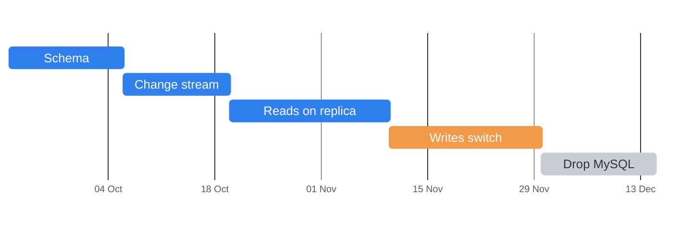
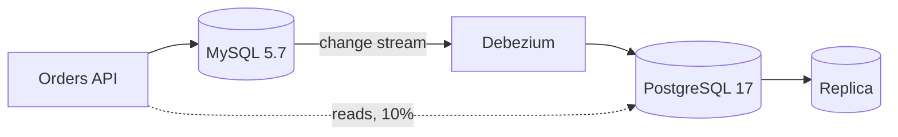

# Move orders to PostgreSQL

Orders move from MySQL 5.7 to PostgreSQL 17, both kept in sync until the
cutover.

## This week

- [x] Compare row counts in all 48 tables
- [x] Load test: 3x the peak, p99 under 40 ms
- [ ] Switch writes in a quiet hour
- [ ] Keep MySQL read-only for two weeks

## Plan

## How it works

## Stages

| Stage            | Owner  | Due    | Status      |
| ---------------- | ------ | ------ | ----------- |
| Schema and types | Anna   | 6 Oct  | Done        |
| Change stream    | Marco  | 20 Oct | Done        |
| Reads on replica | Anna   | 10 Nov | Done        |
| Writes switch    | Li Wei | 30 Nov | In progress |
| Drop MySQL       | Marco  | 15 Dec | Planned     |

## Rollback

Point the API back to MySQL in the config and restart it. The change stream
keeps MySQL up to date until the end of the cutover, so no order is lost.
