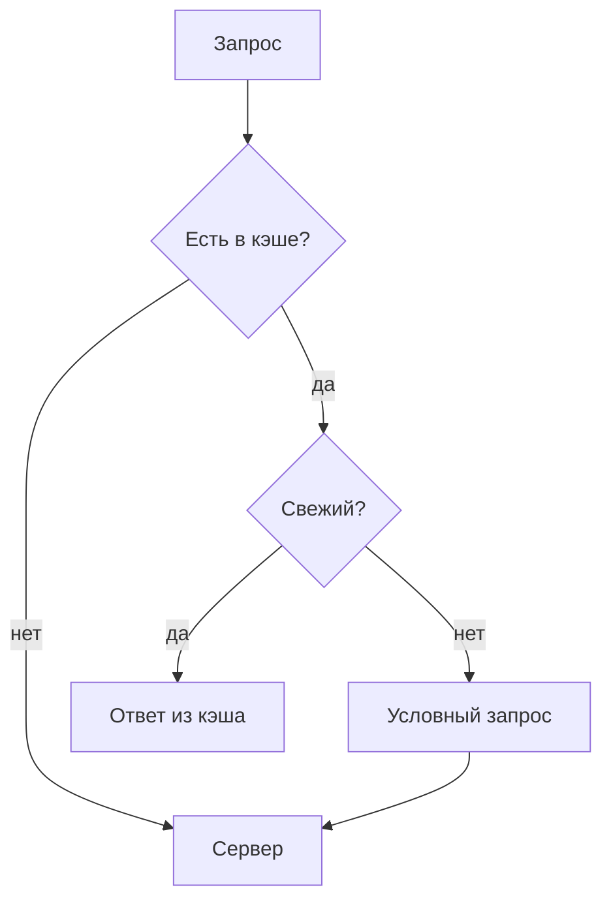
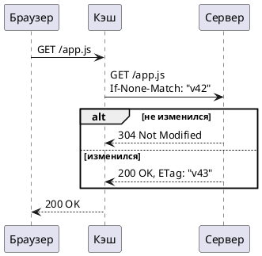

# Кэширование в HTTP

Витрина всех элементов разметки в одной заметке: по ней удобно проверять, как
правки темы и стилей влияют на читаемость. Текст настоящий, чтобы глаз читал
его, как обычную заметку, а не как список образцов. Назад к
[оглавлению](../index.md).

## Коротко

Браузер хранит ответ у себя и **не ходит за ним повторно**, пока ответ
_свежий_. Когда срок вышел, он спрашивает сервер, _изменилось ли что-то_, и
получает либо новый ответ, либо короткое **«не изменилось»** - статус
`304 Not Modified` без тела. Всё это задаёт один заголовок, `Cache-Control`, и
пара заголовков проверки: `ETag` и `Last-Modified`.

Самая частая ошибка - путать `no-cache` и `no-store`. _**Первый разрешает
хранить ответ**_, но требует проверки перед каждым использованием, а второй
запрещает хранить вообще. ~~Раньше рекомендовали `Pragma: no-cache`~~, но этот
заголовок давно устарел и современные браузеры его не читают.

Полезные сочетания клавиш: <kbd>Ctrl</kbd>+<kbd>Shift</kbd>+<kbd>R</kbd>
перезагружает страницу в обход кэша, а <kbd>F12</kbd> открывает вкладку
**Network**, где видно, откуда пришёл ответ. Главное, что стоит запомнить,
выделено: <mark>свежесть считает браузер, а не сервер</mark>.

Химия и математика тоже встречаются в заметках: H<sub>2</sub>O, 2<sup>10</sup>
= 1024, а время жизни ответа считается как $t_{fresh} = max\text{-}age - age$.
Подробности в [RFC 9111](https://www.rfc-editor.org/rfc/rfc9111) и в
[заметке про shell](../notes/shell-cookbook.md); ссылка на
[несуществующую страницу](missing-page.md) должна выглядеть сломанной. Голая
ссылка тоже работает: https://developer.mozilla.org/docs/Web/HTTP/Caching.

## Директивы Cache-Control

| Директива    | Кто читает       | Что значит                                   |
| ------------ | ---------------- | -------------------------------------------- |
| `max-age=N`  | браузер и прокси | ответ свежий **N секунд**                    |
| `s-maxage=N` | только прокси    | то же, но для общего кэша                    |
| `no-cache`   | все              | хранить можно, использовать _после проверки_ |
| `no-store`   | все              | не хранить **совсем**                        |
| `private`    | все              | только в кэше браузера                       |
| `immutable`  | браузер          | не проверять, пока ответ свежий              |

### Выравнивание в таблице

| Ресурс       | Размер, КБ | Хиты за день | Доля |
| :----------- | ---------: | -----------: | :--: |
| `app.js`     |        412 |       18 204 | 61 % |
| `styles.css` |         38 |        9 877 | 33 % |
| `logo.svg`   |          4 |        1 732 | 6 %  |

## Как сервер отдаёт заголовки

Обработчик на Go ставит долгий срок для файлов с хэшем в имени и короткий для
всего остального:

```go
func cacheHeaders(next http.Handler) http.Handler {
	return http.HandlerFunc(func(w http.ResponseWriter, r *http.Request) {
		if hashed.MatchString(r.URL.Path) {
			// the name changes with the content, so the file never goes stale
			w.Header().Set("Cache-Control", "public, max-age=31536000, immutable")
		} else {
			w.Header().Set("Cache-Control", "no-cache")
		}
		next.ServeHTTP(w, r)
	})
}
```

То же самое на Python, с проверкой `ETag`:

```python
from hashlib import sha256

def respond(request, body: bytes) -> Response:
    tag = '"' + sha256(body).hexdigest()[:16] + '"'
    if request.headers.get("If-None-Match") == tag:
        return Response(status=304)
    return Response(body, headers={"ETag": tag, "Cache-Control": "no-cache"})
```

Проверка из терминала, с очень длинной строкой, чтобы блок прокручивался вбок:

```bash
curl -sI https://example.com/static/app.3f9a2c.js | grep -iE '^(cache-control|etag|age|last-modified):'
curl -sI -H 'If-None-Match: "3f9a2c1b"' https://example.com/static/app.3f9a2c.js   # ждём 304 Not Modified
```

Настройка прокси и отчёт по хитам:

```yaml
cache:
  path: /var/cache/nginx
  max_size: 2g
  rules:
    - match: "~*\\.(js|css|svg)$"
      ttl: 365d
    - match: "/api/"
      ttl: 0
```

```sql
select date_trunc('hour', requested_at) as hour,
       count(*) filter (where cache_status = 'HIT') * 100.0 / count(*) as hit_ratio
from access_log
where requested_at > now() - interval '1 day'
group by 1
order by 1;
```

```json
{
  "url": "/static/app.3f9a2c.js",
  "status": 200,
  "headers": { "cache-control": "public, max-age=31536000, immutable" },
  "fromCache": true
}
```

```diff
- Cache-Control: max-age=3600
+ Cache-Control: no-cache
+ ETag: "3f9a2c1b"
```

Блок без языка, как его пишут для вывода команды:

```
HTTP/2 304
cache-control: no-cache
etag: "3f9a2c1b"
age: 0
```

## Цитаты и предупреждения

> Есть только две трудные вещи в компьютерных науках: **инвалидация кэша** и
> придумывание _названий_.
>
> _Фил Карлтон_

> Вложенная цитата бывает в переписке:
>
> > Почему пользователи видят старую версию после релиза?
>
> Потому что `index.html` отдавался с `max-age=86400`, и браузер не спрашивал
> сервер целые сутки.

> [!NOTE]
> Ответ с `Cache-Control: no-cache` **хранится**, он просто проверяется перед
> каждым использованием.

> [!TIP]
> Добавляйте хэш содержимого в имя файла (`app.3f9a2c.js`) и ставьте
> `immutable`: такой файл никогда не устареет.

> [!IMPORTANT]
> `s-maxage` перекрывает `max-age` только для **общих** кэшей, браузер его
> игнорирует.

> [!WARNING]
> Ответ с заголовком `Set-Cookie` и директивой `public` может уйти в общий кэш
> и достаться _другому пользователю_.

> [!CAUTION]
> Никогда не кэшируйте в общем кэше ответы с личными данными. Ставьте
> `private` или `no-store`.

## Списки

Что проверить перед релизом:

- [x] у файлов с хэшем стоит `max-age=31536000, immutable`
- [x] `index.html` отдаётся с `no-cache`
- [ ] у ответов API есть `ETag`
- [ ] ответы с `Set-Cookie` помечены как `private`

Порядок, в котором браузер решает, что делать с запросом:

1. Найти ответ в кэше по **методу и адресу**.
2. Проверить заголовок `Vary`: совпадают ли нужные заголовки запроса.
3. Посчитать свежесть:
   1. взять `max-age`, а если его нет, то `Expires`;
   2. вычесть возраст ответа (`Age`);
   3. если ничего не задано, применить _эвристику_ - обычно 10 % от времени с
      `Last-Modified`.
4. Если ответ свежий, отдать его **без запроса** к серверу.
5. Иначе отправить условный запрос с `If-None-Match` или `If-Modified-Since`.

Где живёт кэш:

- **Кэш браузера** - личный, на диске и в памяти.
  - память: быстрый, до закрытия вкладки;
  - диск: переживает перезапуск.
- **Общий кэш** - прокси или CDN, один на многих пользователей.
- **Service Worker** - код на странице, который решает _сам_.

Термины:

<dl>
  <dt>Свежесть</dt>
  <dd>Время, в течение которого ответ можно использовать без проверки.</dd>
  <dt>Валидатор</dt>
  <dd>Значение, по которому сервер узнаёт версию: <code>ETag</code> или дата
  <code>Last-Modified</code>.</dd>
</dl>

## Схема и формула



Условный запрос по шагам, на PlantUML:



Где стоят кэши, в нотации C4 из стандартной библиотеки PlantUML:

```plantuml
!include <C4/C4_Container>
Person(reader, "Читатель")
System_Boundary(edge, "Край сети") {
  Container(cdn, "CDN", "Varnish", "общий кэш")
}
Container(app, "Приложение", "Go", "отдаёт ETag")
Rel(reader, cdn, "GET")
Rel(cdn, app, "If-None-Match")
```

Доля попаданий в кэш за период:

$$
hit\ ratio = \frac{hits}{hits + misses} \times 100\%
$$

## Картинка и раскрывающийся блок


<details>
<summary>Полный ответ сервера с заголовками</summary>

```
HTTP/2 200
content-type: application/javascript
cache-control: public, max-age=31536000, immutable
etag: "3f9a2c1b"
last-modified: Tue, 14 Oct 2026 09:12:00 GMT
age: 5312
```

</details>

---

## Заголовки всех уровней

### Третий уровень

Обычный абзац под заголовком третьего уровня, чтобы видеть отступы.

#### Четвёртый уровень

Абзац под четвёртым уровнем с **жирным** и _курсивом_.

##### Пятый уровень

Абзац под пятым уровнем.

###### Шестой уровень

Абзац под шестым уровнем, заголовок над ним приглушён.

## Сноски

Эвристика в 10 % описана в стандарте[^heuristic], а директиву `immutable`
первым поддержал Firefox[^immutable].

[^heuristic]:
    RFC 9111, раздел 4.2.2: кэш может считать ответ свежим часть времени,
    прошедшего с `Last-Modified`.

[^immutable]: Firefox 49, 2016 год.
