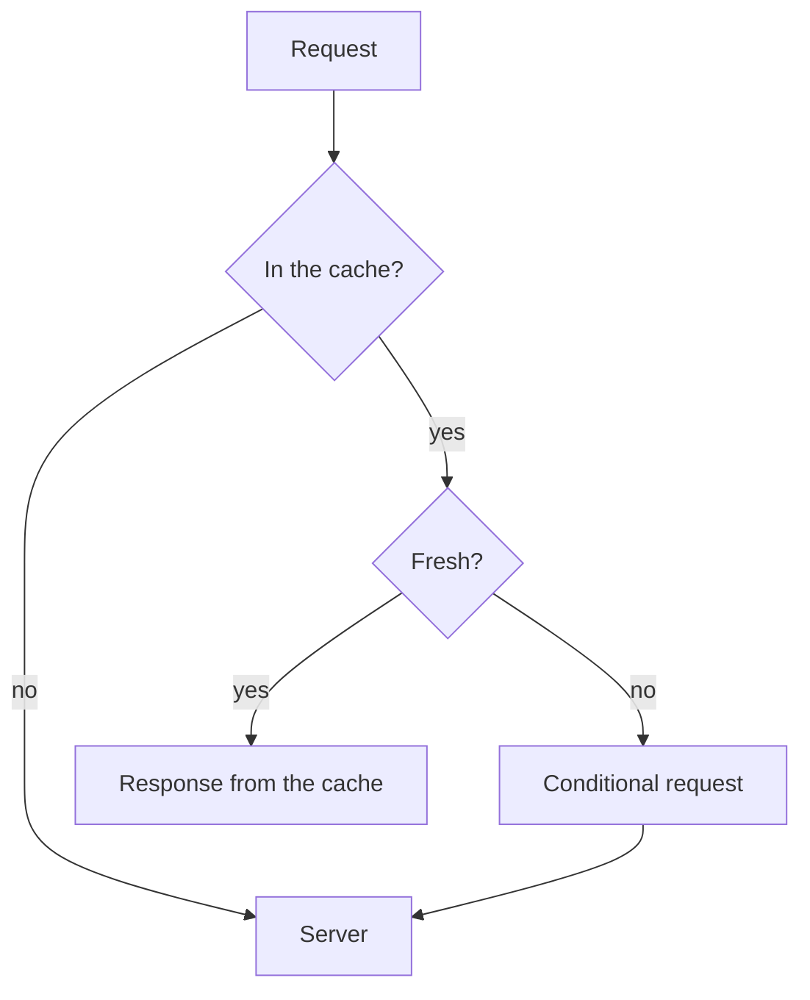
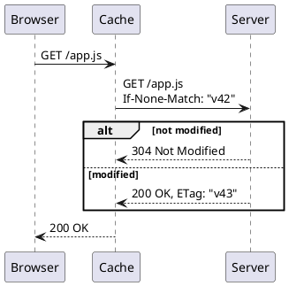

# Caching in HTTP

A showcase of every markup element in one note: it makes it easy to check how
changes to the theme and styles affect readability. The text is real, so the
eye reads it like a normal note and not like a list of samples. Back to the
[contents](../index.md).

## In short

The browser keeps a response and **does not fetch it again** while the
response is _fresh_. When the time runs out, it asks the server _whether
anything changed_ and gets either a new response or a short
**"not modified"** - status `304 Not Modified` with no body. All of this is
set by one header, `Cache-Control`, and a pair of validation headers: `ETag`
and `Last-Modified`.

The most common mistake is to mix up `no-cache` and `no-store`. _**The first
allows storing the response**_ but requires a check before every use, while
the second forbids storing it at all.
~~People used to recommend `Pragma: no-cache`~~, but this header is long
obsolete and modern browsers do not read it.

Useful shortcuts: <kbd>Ctrl</kbd>+<kbd>Shift</kbd>+<kbd>R</kbd> reloads the
page bypassing the cache, and <kbd>F12</kbd> opens the **Network** tab, where
you can see where a response came from. The main thing to remember is
highlighted: <mark>freshness is computed by the browser, not the server</mark>.

Chemistry and math show up in notes too: H<sub>2</sub>O, 2<sup>10</sup> =
1024, and the lifetime of a response is computed as
$t_{fresh} = max\text{-}age - age$. Details are in
[RFC 9111](https://www.rfc-editor.org/rfc/rfc9111) and in the
[note on the shell](../notes/shell-cookbook.md); a link to a
[page that does not exist](missing-page.md) should look broken. A bare link
works too: https://developer.mozilla.org/docs/Web/HTTP/Caching.

## Cache-Control directives

| Directive    | Read by           | Meaning                                     |
| ------------ | ----------------- | ------------------------------------------- |
| `max-age=N`  | browser and proxy | the response is fresh for **N seconds**     |
| `s-maxage=N` | proxies only      | the same, but for a shared cache            |
| `no-cache`   | all               | may be stored, used _after validation_      |
| `no-store`   | all               | not stored **at all**                       |
| `private`    | all               | only in the browser cache                   |
| `immutable`  | browser           | not revalidated while the response is fresh |

### Table alignment

| Resource     | Size, KB | Hits per day | Share |
| :----------- | -------: | -----------: | :---: |
| `app.js`     |      412 |       18,204 |  61%  |
| `styles.css` |       38 |        9,877 |  33%  |
| `logo.svg`   |        4 |        1,732 |  6%   |

## How the server sends headers

A Go handler sets a long lifetime for files with a hash in the name and a
short one for everything else:

```go
func cacheHeaders(next http.Handler) http.Handler {
	return http.HandlerFunc(func(w http.ResponseWriter, r *http.Request) {
		if hashed.MatchString(r.URL.Path) {
			// the name changes with the content, so the file never goes stale
			w.Header().Set("Cache-Control", "public, max-age=31536000, immutable")
		} else {
			w.Header().Set("Cache-Control", "no-cache")
		}
		next.ServeHTTP(w, r)
	})
}
```

The same in Python, with an `ETag` check:

```python
from hashlib import sha256

def respond(request, body: bytes) -> Response:
    tag = '"' + sha256(body).hexdigest()[:16] + '"'
    if request.headers.get("If-None-Match") == tag:
        return Response(status=304)
    return Response(body, headers={"ETag": tag, "Cache-Control": "no-cache"})
```

A check from the terminal, with a very long line so the block scrolls
sideways:

```bash
curl -sI https://example.com/static/app.3f9a2c.js | grep -iE '^(cache-control|etag|age|last-modified):'
curl -sI -H 'If-None-Match: "3f9a2c1b"' https://example.com/static/app.3f9a2c.js   # expect 304 Not Modified
```

The proxy config and a report on hits:

```yaml
cache:
  path: /var/cache/nginx
  max_size: 2g
  rules:
    - match: "~*\\.(js|css|svg)$"
      ttl: 365d
    - match: "/api/"
      ttl: 0
```

```sql
select date_trunc('hour', requested_at) as hour,
       count(*) filter (where cache_status = 'HIT') * 100.0 / count(*) as hit_ratio
from access_log
where requested_at > now() - interval '1 day'
group by 1
order by 1;
```

```json
{
  "url": "/static/app.3f9a2c.js",
  "status": 200,
  "headers": { "cache-control": "public, max-age=31536000, immutable" },
  "fromCache": true
}
```

```diff
- Cache-Control: max-age=3600
+ Cache-Control: no-cache
+ ETag: "3f9a2c1b"
```

A block with no language, the way command output is written:

```
HTTP/2 304
cache-control: no-cache
etag: "3f9a2c1b"
age: 0
```

## Quotes and alerts

> There are only two hard things in Computer Science: **cache invalidation**
> and naming _things_.
>
> _Phil Karlton_

> A nested quote happens in a conversation:
>
> > Why do users see the old version after a release?
>
> Because `index.html` was served with `max-age=86400`, and the browser did
> not ask the server for a whole day.

> [!NOTE]
> A response with `Cache-Control: no-cache` **is stored**, it is just checked
> before every use.

> [!TIP]
> Put a hash of the content into the file name (`app.3f9a2c.js`) and set
> `immutable`: such a file never goes stale.

> [!IMPORTANT]
> `s-maxage` overrides `max-age` only for **shared** caches, the browser
> ignores it.

> [!WARNING]
> A response with a `Set-Cookie` header and the `public` directive can end up
> in a shared cache and reach _another user_.

> [!CAUTION]
> Never store responses with personal data in a shared cache. Set `private`
> or `no-store`.

## Lists

What to check before a release:

- [x] files with a hash have `max-age=31536000, immutable`
- [x] `index.html` is served with `no-cache`
- [ ] API responses have an `ETag`
- [ ] responses with `Set-Cookie` are marked `private`

The order in which the browser decides what to do with a request:

1. Find a response in the cache by **method and URL**.
2. Check the `Vary` header: do the needed request headers match.
3. Compute freshness:
   1. take `max-age`, and if it is missing, `Expires`;
   2. subtract the age of the response (`Age`);
   3. if nothing is set, apply a _heuristic_ - usually 10% of the time since
      `Last-Modified`.
4. If the response is fresh, return it **without a request** to the server.
5. Otherwise send a conditional request with `If-None-Match` or
   `If-Modified-Since`.

Where the cache lives:

- **Browser cache** - private, on disk and in memory.
  - memory: fast, lasts until the tab is closed;
  - disk: survives a restart.
- **Shared cache** - a proxy or a CDN, one for many users.
- **Service Worker** - code on the page that decides _on its own_.

Terms:

<dl>
  <dt>Freshness</dt>
  <dd>The time during which a response can be used without a check.</dd>
  <dt>Validator</dt>
  <dd>A value by which the server knows the version: <code>ETag</code> or the
  <code>Last-Modified</code> date.</dd>
</dl>

## Diagram and formula



A conditional request step by step, in PlantUML:



Where the caches sit, in C4 notation from the PlantUML standard library:

```plantuml
!include <C4/C4_Container>
Person(reader, "Reader")
System_Boundary(edge, "Network edge") {
  Container(cdn, "CDN", "Varnish", "shared cache")
}
Container(app, "Application", "Go", "sends ETag")
Rel(reader, cdn, "GET")
Rel(cdn, app, "If-None-Match")
```

The cache hit ratio over a period:

$$
hit\ ratio = \frac{hits}{hits + misses} \times 100\%
$$

## Image and collapsible block


<details>
<summary>The full server response with headers</summary>

```
HTTP/2 200
content-type: application/javascript
cache-control: public, max-age=31536000, immutable
etag: "3f9a2c1b"
last-modified: Tue, 14 Oct 2026 09:12:00 GMT
age: 5312
```

</details>

---

## Headings of every level

### Third level

A plain paragraph under a third-level heading, to see the spacing.

#### Fourth level

A paragraph under the fourth level with **bold** and _italic_.

##### Fifth level

A paragraph under the fifth level.

###### Sixth level

A paragraph under the sixth level, the heading above it is muted.

## Footnotes

The 10% heuristic is described in the standard[^heuristic], and Firefox was
the first to support the `immutable` directive[^immutable].

[^heuristic]:
    RFC 9111, section 4.2.2: a cache may treat a response as fresh for a part
    of the time that has passed since `Last-Modified`.

[^immutable]: Firefox 49, 2016.
