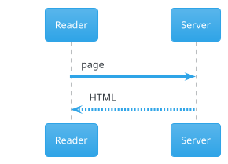
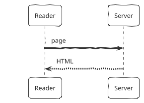
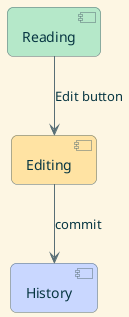
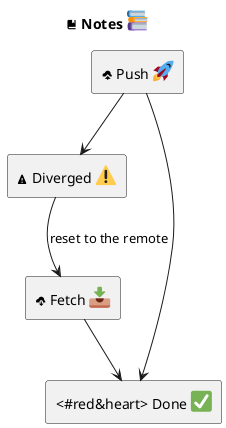
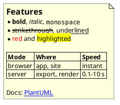

# Look

## Themes

The same diagram in two themes:





## Own colors and style



## Icons and emoji



## Text: lists, tables, links



## Very wide

The page shows it smaller; open it to see it at full size.

```plantuml
@startuml
left to right direction
rectangle "Draft" as s1
rectangle "Edit" as s2
rectangle "Prettier" as s3
rectangle "Write" as s4
rectangle "Index" as s5
rectangle "Commit" as s6
rectangle "Push" as s7
rectangle "Webhook" as s8
rectangle "Fetch" as s9
rectangle "Merge --ff-only" as s10
rectangle "Page cache" as s11
rectangle "Reader" as s12
s1 --> s2
s2 --> s3
s3 --> s4
s4 --> s5
s5 --> s6
s6 --> s7
s7 --> s8
s8 --> s9
s9 --> s10
s10 --> s11
s11 --> s12
@enduml
```



## Very small

```plantuml
(Note)
```
