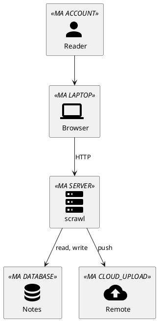
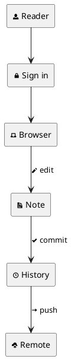

# Icon sets

The icon sets of PlantUML's standard library, one diagram each. A set is loaded
only when a diagram includes it.

## Material Design Icons

Version 2, the default one, through its macros:



Version 7, its sprites in the text:

```plantuml
@startuml
!include <material7/AccountUser/Account>
!include <material7/DeviceTech/Laptop>
!include <material7/Database/Database>
!include <material7/Cloud/CloudSync>
!include <material7/FilesFolders/FileDocument>
rectangle "<$mdiAccount>\nReader" as reader
rectangle "<$mdiLaptop>\nBrowser" as browser
rectangle "<$mdiFileDocument>\nNote" as note
rectangle "<$mdiDatabase>\nHistory" as history
rectangle "<$mdiCloudSync>\nRemote" as remote
reader --> browser
browser --> note : edit
note --> history : commit
history --> remote : push
@enduml
```

## Bootstrap Icons

```plantuml
@startuml
!include <bootstrap/bootstrap>
rectangle "<$bi-person-circle{scale=2}>\nReader" as reader
rectangle "<$bi-phone{scale=2}>\nPhone" as phone
rectangle "<$bi-laptop{scale=2}>\nLaptop" as laptop
rectangle "<$bi-hdd-stack{scale=2,color=#0d6efd}>\nscrawl" as app
rectangle "<$bi-git{scale=2,color=#f05033}>\nGit" as git
reader --> phone
reader --> laptop
phone --> app
laptop --> app
app --> git : commit, push
@enduml
```

## OpenIconic

Built in, with no include:


