# UML

## Sequence

Small:

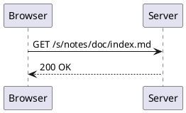

Large: saving a note with formatting, history and a push to the remote.

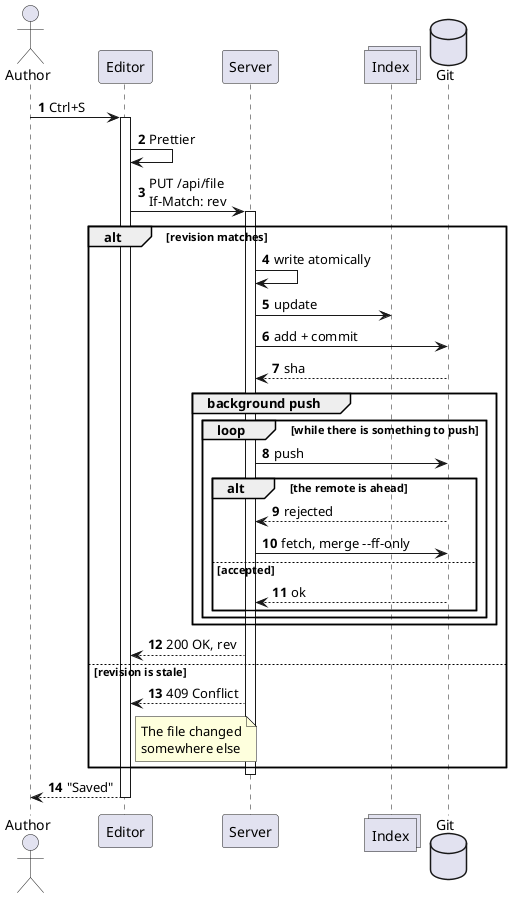

## Class

Medium:

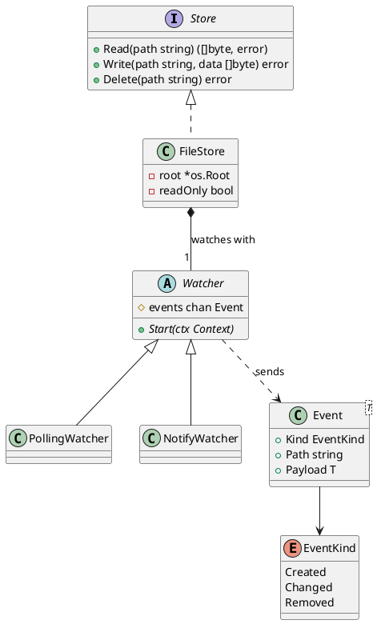

Large, in three packages:

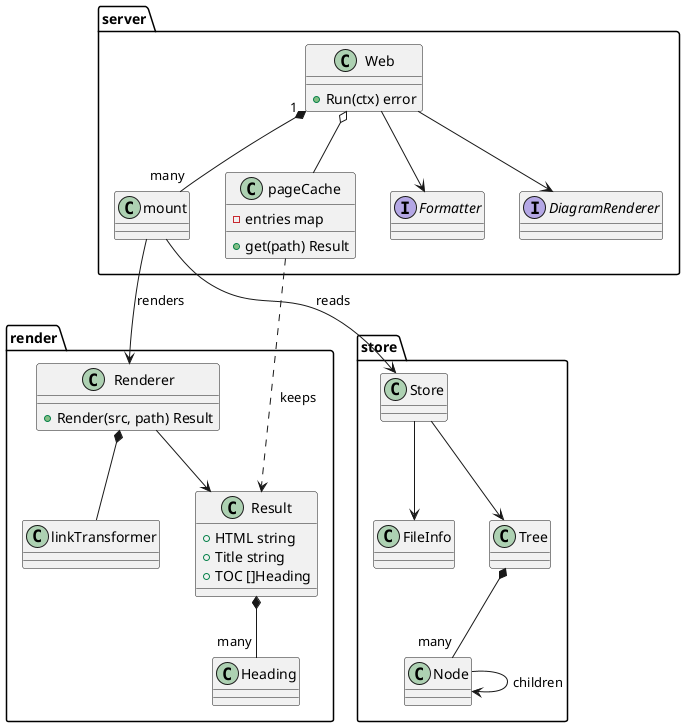

## Activity

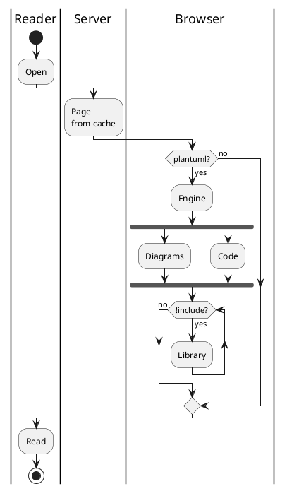

## State

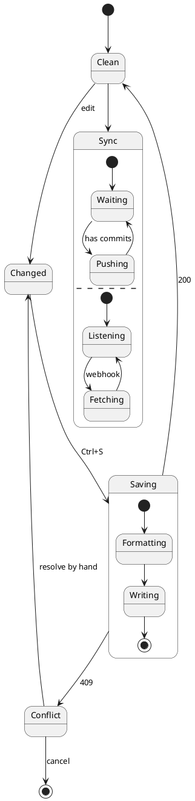

## Use case

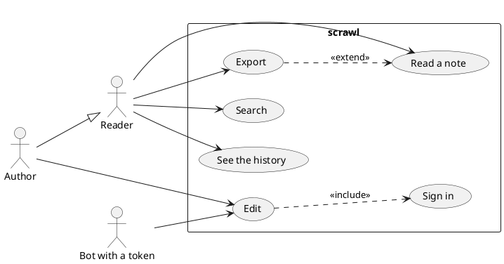

## Component

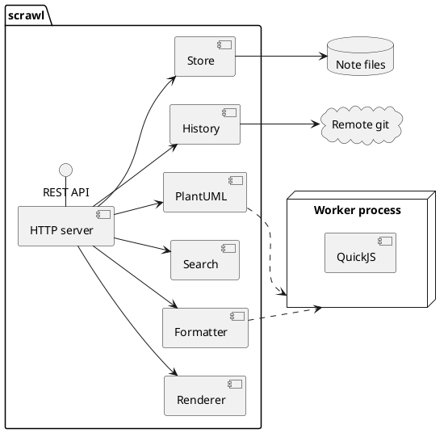

## Deployment

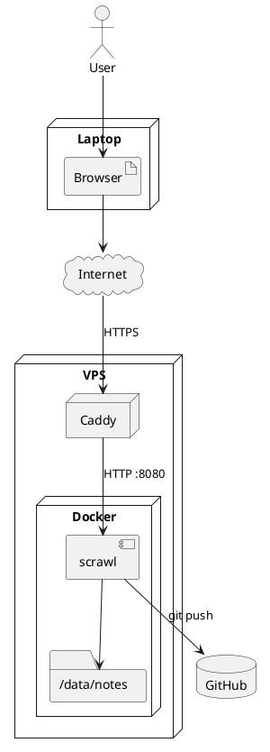

## Object

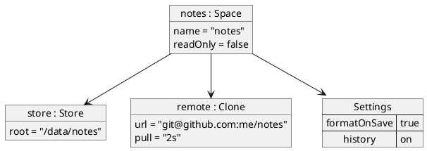

## Timing

Time is in tenths of a second:

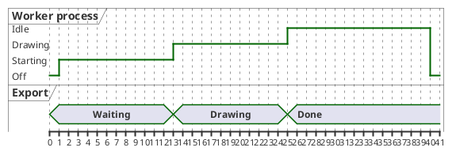
