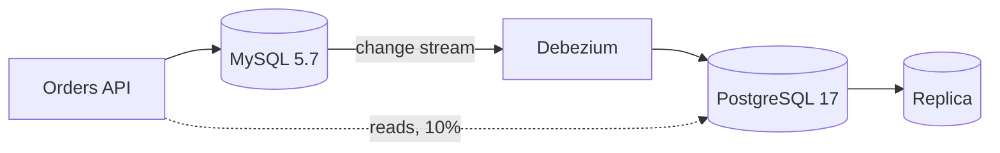
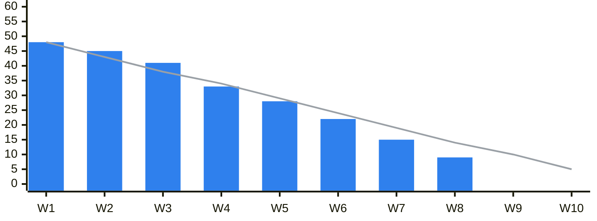

# Move orders to PostgreSQL

The orders service moves from MySQL 5.7 to PostgreSQL 17. Both databases stay
in sync until the cutover, so we can switch back at any time.

## How it works

## Progress

## Stages

| Stage            | Owner  | Due    | Status      |
| ---------------- | ------ | ------ | ----------- |
| Schema and types | Anna   | 6 Oct  | Done        |
| Change stream    | Marco  | 20 Oct | Done        |
| Reads on replica | Anna   | 10 Nov | Done        |
| Writes switch    | Li Wei | 30 Nov | In progress |
| Drop MySQL       | Marco  | 15 Dec | Planned     |

## Cutover

- [x] Freeze schema changes
- [x] Compare row counts in all 48 tables
- [x] Load test: 3x the peak, p99 under 40 ms
- [ ] Switch writes in a quiet hour
- [ ] Keep MySQL read-only for two weeks
